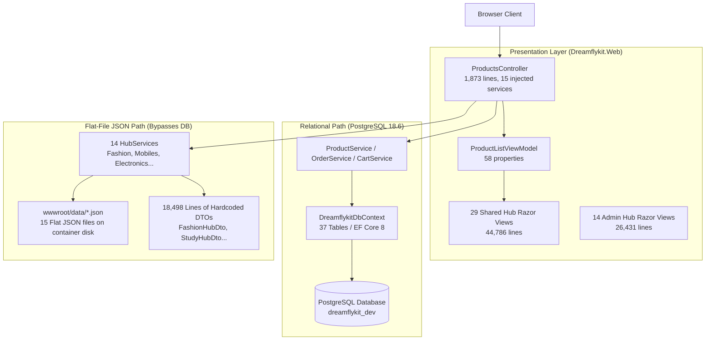
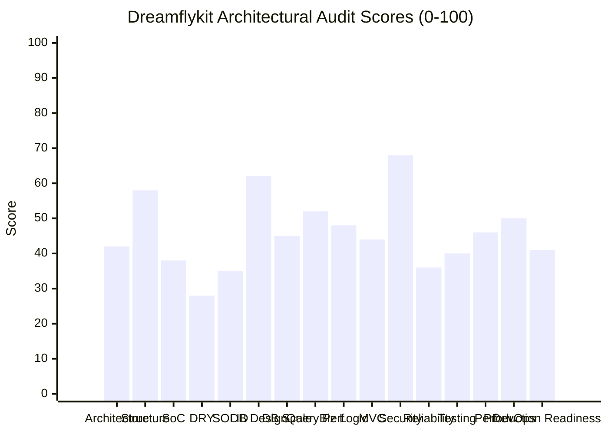

# 01. EXECUTIVE ARCHITECTURAL SUMMARY: DREAMFLYKIT

**Application Name:** Dreamflykit  
**Tagline:** "Your Journey. Our Kit."  
**Business Model:** Destination-aware travel and study-abroad essentials, curated country-specific kits, and general multi-category e-commerce marketplace.  
**Audit Role:** Principal Software Architect, PostgreSQL Database Architect, Performance Engineer & Application Security Architect.  
**Audit Scope:** Entire Visual Studio Solution (6 projects), 115 unit tests, PostgreSQL 18.6 live database schema, EF Core migrations, Docker containerization, security policies, and performance scaling.  
**Audit Type:** Strict Read-Only Audit (Zero modifications performed).

---

## 1. Executive Verdict & Bottom-Line Assessment

Dreamflykit represents an ambitious, visually rich e-commerce platform targeting student travel and destination kits alongside general e-commerce categories. The application builds cleanly and exhibits strong foundational strengths in specific areas:
- ASP.NET Core Identity authentication with strict 12-character password complexity and account lockout policies.
- Clean separation between core relational tables (`Products`, `ProductVariants`, `Categories`, `Subcategories`, `InventoryItems`, `Orders`, `Carts`, `CustomerAddresses`) in EF Core.
- Multi-stage non-root Docker runtime containerization (`UID 1654`).
- CSRF auto-validation and security response headers.

**However, the audit has identified critical structural, concurrency, and data-integrity defects that currently prevent Dreamflykit from being production-ready or scalable.**

The central architectural finding of this audit is a **Split-Brain Architectural Disconnect**:
While a relational PostgreSQL schema exists for standard e-commerce, all high-traffic Category Landing Hubs (Fashion, Mobiles, Electronics, Appliances, Beauty, Food, Travel, Luggage, StoryBooks, Gaming, Sports, Country Kits, 3-Section Sliders) **completely bypass PostgreSQL**. Instead, they read and write to **flat JSON files stored on local disk** in `wwwroot/data/*.json` and hold over **89,000 lines of hardcoded C# DTOs, default builders, and Razor markup**.

---

## 2. Top 5 Critical Architectural Findings

| Finding ID | Severity | Component | Finding Summary | Business & Technical Impact |
| :--- | :--- | :--- | :--- | :--- |
| **CRIT-01** | **CRITICAL** | `CountryKitsHubService.cs` (lines 43, 91) | **Fatal Recursive Deadlock in `SemaphoreSlim`** | Any admin save or cache expiration triggers a recursive semaphore wait on the same thread, completely freezing HTTP requests and locking the web process until worker restart. |
| **CRIT-02** | **CRITICAL** | Architecture / Persistence | **Split-Brain Flat-File JSON Architecture** | 14 category hubs manage products, banners, and categories in flat files (`wwwroot/data/*.json`). In Docker / multi-instance VPS deployments, container restarts wipe data; concurrent admin saves cause file corruption. |
| **CRIT-03** | **CRITICAL** | Database Referential Integrity | **Missing Foreign Keys to `AspNetUsers`** | `Orders.UserId`, `CustomerAddresses.UserId`, `Carts.UserId`, `Wishlists.UserId`, `MediaPermissions.UserId`, and `Products.SellerId` have NO database-level foreign key constraints to `AspNetUsers.Id`. User deletion or corruption leaves orphaned transactional records. |
| **CRIT-04** | **CRITICAL** | `ProductsController.cs` & `ProductListViewModel.cs` | **Extreme God Controller (1,873 lines, 15 services, 58 properties)** | `ProductsController` acts as a procedural router for 14 unrelated business domains, injecting 15 services and inflating `ProductListViewModel` to 58 properties. Massive violation of SRP, OCP, and Clean Architecture. |
| **CRIT-05** | **CRITICAL** | Concurrency & Idempotency | **Payment Webhook Non-Idempotency & Race Conditions** | Cashfree webhook and redirect callback both attempt status transition from `Pending` to `Confirmed`. A duplicate webhook or fast callback causes `EnsureStatus()` to throw `DomainException`, resulting in 400 errors, Cashfree retry storms, and broken order states. |

---

## 3. High-Level Compliance Scorecard Summary

Dreamflykit was evaluated across 16 formal dimensions on a 0-100 scale:

- **Overall Production Readiness Score:** **41 / 100 (Unready for Live Production)**
- **Strongest Dimensions:** Application Security (68/100), Core Database Table Schema (62/100), Solution Project Packaging (58/100).
- **Weakest Dimensions:** DRY / Code Duplication (28/100), SOLID Principles (35/100), Concurrency & Reliability (36/100), Separation of Concerns (38/100).

---

## 4. Prioritized Remediation Roadmap Overview

A 10-Phase refactoring plan has been formulated in **Report 23** to elevate Dreamflykit from its current prototype state (41/100) to an enterprise-grade production platform (90+/100):
1. **Phase 1 (Immediate / Week 1):** Eliminate fatal deadlocks (`CountryKitsHubService`), fix payment webhook idempotency, and wrap order/inventory operations in explicit database transactions.
2. **Phase 2 (Database Integrity / Week 2):** Add missing foreign keys to `AspNetUsers`, migrate pending `AuditLogs` and database check constraints into PostgreSQL.
3. **Phase 3 (Hub Unification / Weeks 3-4):** Unify all 14 flat-file Hubs into the relational database catalogue schema, deprecating disk JSON files.
4. **Phase 4 (DRY & SRP Refactoring / Weeks 5-6):** Decompose the 1,873-line `ProductsController` into dedicated category controllers and reusable Razor View Components.
5. **Phase 5 (Performance & Indexing / Week 7):** Add missing B-tree, partial, and trigram search indexes; configure Redis distributed caching.
6. **Phase 6 (Core Missing Features / Weeks 8-9):** Implement Password Reset / Forgot Password, automated Email/SMS notifications, and real Refund processing.
7. **Phase 7 (Fulfillment & Shipping / Week 10):** Integrate shipping provider carrier abstractions (Shiprocket / Delhivery) and tracking webhooks.
8. **Phase 8 (Security Hardening / Week 11):** Enforce Admin MFA, IP rate limiting, and brute-force lockout on customer endpoints.
9. **Phase 9 (Testing Overhaul / Week 12):** Replace mock-DTO tests with PostgreSQL Testcontainers integration testing for checkout and inventory.
10. **Phase 10 (DevOps & Hostinger VPS / Week 13):** Mount persistent Docker volumes, align PostgreSQL versions, set up Nginx reverse proxy with SSL, and automate GitHub Actions CI/CD.

---

## 5. Verification Notice
Every finding documented across these 24 audit reports is backed by verified code paths, live PostgreSQL 18.6 schema dumps, exact line numbers, and empirical test execution logs.
