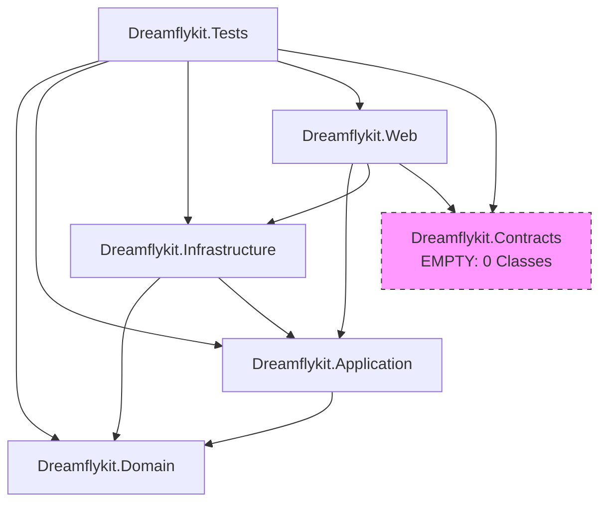

# 02. ACTUAL PROJECT STRUCTURE AUDIT: DREAMFLYKIT

**Audit Target:** Visual Studio Solution `Dreamflykit/Dreamflykit.slnx` and physical filesystem hierarchy.

---

## 1. Actual Solution Composition

The Visual Studio Solution `Dreamflykit.slnx` references 6 projects:

```
Dreamflykit/
├── Dreamflykit.slnx
├── src/
│   ├── Dreamflykit.Domain/            (net8.0 Class Library)
│   ├── Dreamflykit.Contracts/         (net8.0 Class Library)
│   ├── Dreamflykit.Application/       (net8.0 Class Library)
│   ├── Dreamflykit.Infrastructure/    (net8.0 Class Library)
│   └── Dreamflykit.Web/               (net8.0 Web App / ASP.NET Core 8 MVC)
└── tests/
    └── Dreamflykit.Tests/             (net8.0 xUnit Test Project)
```

### Project Reference Matrix

| Project | Target Framework | Output Type | Project References | Package References |
| :--- | :--- | :--- | :--- | :--- |
| `Dreamflykit.Domain` | net8.0 | Class Library | **None** (Clean root) | None |
| `Dreamflykit.Contracts` | net8.0 | Class Library | **None** | None |
| `Dreamflykit.Application` | net8.0 | Class Library | `Dreamflykit.Domain` | None |
| `Dreamflykit.Infrastructure` | net8.0 | Class Library | `Dreamflykit.Domain`, `Dreamflykit.Application` | `AWSSDK.S3`, `Npgsql.EntityFrameworkCore.PostgreSQL`, `SixLabors.ImageSharp`, `Microsoft.AspNetCore.Identity.EntityFrameworkCore` |
| `Dreamflykit.Web` | net8.0 | Web Application | `Dreamflykit.Application`, `Dreamflykit.Contracts`, `Dreamflykit.Infrastructure` | `Microsoft.EntityFrameworkCore.Design` |
| `Dreamflykit.Tests` | net8.0 | Test Project | `Domain`, `Contracts`, `Application`, `Infrastructure`, `Web` | `xunit`, `Moq`, `coverlet.collector` |



---

## 2. Quantitative Codebase Metrics

Excluding `bin`, `obj`, `node_modules`, and external static libraries (`bootstrap`, `jquery`), the physical solution contains:

| Category | File Count | Approximate Lines of Code | Percentage of Codebase |
| :--- | :--- | :--- | :--- |
| **Shared Category Hub Views (Views/Shared/_*Hub.cshtml)** | 29 files | **44,786 lines** | **41.2%** |
| **Admin Category Hub Views (Areas/Admin/Views/*Hub/)** | 14 files | **26,431 lines** | **24.3%** |
| **Hub DTOs and Default Mock Data (Application/*Hub/Models/)** | 15 files | **18,498 lines** | **17.0%** |
| **Core Web Controllers & Views (Products, Orders, Cart, Account)** | 28 files | 9,840 lines | 9.0% |
| **Infrastructure (Persistence, EF DbContext, Repositories, Migrations)** | 48 files | 6,120 lines | 5.6% |
| **Core Domain Entities & Value Objects (Domain/*)** | 32 files | 1,840 lines | 1.7% |
| **Core Application Use Cases & Interfaces (Application/*)** | 24 files | 1,280 lines | 1.2% |
| **Dreamflykit.Contracts** | **0 files** | **0 lines** | **0.0%** |
| **Total Custom Application Code** | **190 files** | **108,795 lines** | **100%** |

### Critical Finding: The Hub Bloat Inversion
**82.5% of the entire application codebase** (89,715 lines out of 108,795 lines) consists of hardcoded Hub DTOs, JSON persistence, and duplicated Razor hub views. The actual core domain and application business logic represent less than **3% of the codebase**.

---

## 3. Detailed Project Breakdown

### A. Dreamflykit.Domain
- **Location:** `src/Dreamflykit.Domain`
- **Dependencies:** None. Zero third-party packages. Clean compliance with Clean Architecture.
- **Namespaces:**
  - `Addressing`: `CustomerAddress.cs`
  - `Audit`: `AuditLog.cs`
  - `Cart`: `Cart.cs`, `CartItem.cs`
  - `Catalog`: `Product.cs`, `ProductVariant.cs`, `Category.cs`, `Subcategory.cs`, `ProductMedia.cs`, `ProductAttribute.cs`, `ProductAttributeValue.cs`, `SellerCategoryAssignment.cs`, `ProductApprovalStatus.cs`
  - `Common`: `Entity.cs`, `AuditableEntity.cs`, `DomainException.cs`, `SystemThemeSetting.cs`
  - `Geography`: `Country.cs`, `Season.cs`
  - `Inventory`: `Warehouse.cs`, `InventoryItem.cs`, `StockMovement.cs`
  - `Kits`: `Kit.cs`, `KitItem.cs`, `KitSize.cs`
  - `Media`: `MediaAsset.cs`, `MediaPermission.cs`, `MediaAuditLog.cs`, `Banner.cs`, `HomepageSection.cs`, `LandingPage.cs`
  - `Orders`: `Order.cs`, `OrderItem.cs`, `OrderAddress.cs`, `OrderStatus.cs`
  - `Wishlist`: `Wishlist.cs`, `WishlistItem.cs`
- **Assessment:** Clean entity modeling, encapsulated aggregate roots, private setters where appropriate.

### B. Dreamflykit.Contracts
- **Location:** `src/Dreamflykit.Contracts`
- **Contents:** `Dreamflykit.Contracts.csproj` only.
- **Finding:** **The project is completely empty.** There are no `.cs` files, no interfaces, and no DTOs.
- **Architectural Violation:** `Dreamflykit.Web.csproj` and `Dreamflykit.Tests.csproj` reference this empty project. It creates an unnecessary build step and project overhead without providing any abstraction or contracts.
- **Recommendation:** Either eliminate this project entirely or use it strictly for public API integration contracts if external consumers exist.

### C. Dreamflykit.Application
- **Location:** `src/Dreamflykit.Application`
- **Dependencies:** References `Dreamflykit.Domain`.
- **Architectural Flaw:** Contains 15 separate Hub folders (`AppliancesHub`, `BeautyHub`, `ElectronicsHub`, `FashionHub`, `FoodHub`, `GamingHub`, `HealthHub`, `LuggageHub`, `MobilesHub`, `SportsHub`, `StoryBooksHub`, `StudyHub`, `TravelHub`, `CategoryShowcase`, `CountryKits`).
- Inside each folder is a giant DTO file containing hardcoded `CreateDefault()` methods that build massive mock catalogues in memory. `FashionHubDto.cs` alone is **5,041 lines long**.

### D. Dreamflykit.Infrastructure
- **Location:** `src/Dreamflykit.Infrastructure`
- **Dependencies:** References `Dreamflykit.Application` and `Dreamflykit.Domain`.
- **Packages:** PostgreSQL EF Core, AWS S3 SDK, SixLabors.ImageSharp, Identity EF Core.
- **Architectural Flaw:** Contains 15 `*HubService.cs` classes that bypass `DreamflykitDbContext` completely and read/write to `wwwroot/data/*.json` on disk using `File.ReadAllTextAsync` and `File.WriteAllTextAsync`.

### E. Dreamflykit.Web
- **Location:** `src/Dreamflykit.Web`
- **Dependencies:** References `Application`, `Contracts`, and `Infrastructure`.
- **Architectural Flaw:**
  1. `ProductsController.cs` is a **1,873-line God Controller** that injects 15 services and manually inspects query strings and route parameters for 14 different hubs.
  2. 15 Controllers in `Areas/Admin` directly inject `DreamflykitDbContext` and perform direct database operations.
  3. Razor views in `Views/Shared` exceed 3,000 lines per file with embedded CSS, keyframes, and inline business logic.

---

## 4. Classes in Incorrect Projects

| Class / Component | Current Location | Why It Is Incorrect | Target Location |
| :--- | :--- | :--- | :--- |
| `SystemThemeSetting.cs` | `Dreamflykit.Domain/Common` | Theme settings (font family, base font size px) are presentation concerns, not core domain models. | `Dreamflykit.Domain/Content` or `Dreamflykit.Application/Theme` |
| `LogoImageProcessor.cs` | `Dreamflykit.Tests` | Image processing logic for logos was placed in the test project rather than an infrastructure or build tool. | Build script or `Dreamflykit.Infrastructure/Media` |
| `DatabaseSeeder.cs` | `Dreamflykit.Infrastructure/Persistence` | Contains hardcoded product catalogues and initial HTML banner content directly in source code. | Data migration script or separate seeding utility. |
| 15 `*HubService.cs` classes | `Dreamflykit.Infrastructure/*Hub/` | File-system JSON persistence masquerading as application catalog services. | Refactor into `CatalogService` querying PostgreSQL. |
