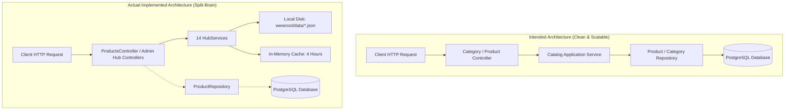

# 03. ARCHITECTURE COMPLIANCE AUDIT: DREAMFLYKIT

**Evaluation Standards:** Clean Architecture, Modular Monolith, SOLID Principles, Separation of Concerns (SoC).

---

## 1. Compliance Against Intended Architecture

The intended architecture for Dreamflykit was specified as:
> *"Modular monolith. Clean Architecture principles. Separation of concerns. SOLID principles. DRY principles. Centralized reusable services. No unnecessary code duplication. No direct database access from controllers. No business logic inside Razor views."*

### Compliance Scorecard

| Architectural Requirement | Status | Compliance Score | Core Evidence |
| :--- | :--- | :--- | :--- |
| **Clean Architecture Layering** | **Violated** | 45% | Controllers directly access `DreamflykitDbContext`; Web references Infrastructure directly. |
| **No Direct DB Access from Controllers** | **Violated** | 20% | 15 presentation controllers inject and query `DreamflykitDbContext` directly. |
| **No Business Logic in Razor Views** | **Violated** | 30% | Views call `@inject` services, execute complex LINQ filtering, and compute prices. |
| **Single Responsibility Principle (SRP)** | **Violated** | 35% | `ProductsController` (1,873 lines, 15 services) handles 14 distinct categories. |
| **DRY (Don't Repeat Yourself)** | **Violated** | 28% | 14 duplicate HubServices, 14 duplicate Admin controllers, duplicate Identity setup. |
| **Persistence Ignorance in Domain** | **Compliant** | 95% | `Dreamflykit.Domain` has 0 third-party packages and no EF Core references. |
| **Database-Driven E-Commerce** | **Violated** | 40% | Split-brain architecture: 14 category hubs bypass PostgreSQL and write flat JSON. |

---

## 2. Major Architectural Violations

### VIOLATION 1: Direct Database Access from Presentation Controllers
**Rule:** No direct database access from controllers; controllers must invoke Application use cases.  
**Reality:** 15 Controllers in `Dreamflykit.Web` directly inject `DreamflykitDbContext`, construct LINQ queries, manage EF change tracking, and invoke `SaveChangesAsync()`.

**Verified Evidence (Controllers Injecting DbContext):**
1. `Areas\Admin\Controllers\OrdersController.cs` (line 13)
2. `Areas\Admin\Controllers\ProductsController.cs`
3. `Areas\Admin\Controllers\CategoriesController.cs`
4. `Areas\Admin\Controllers\BannersController.cs`
5. `Areas\Admin\Controllers\DashboardController.cs`
6. `Areas\Admin\Controllers\HeaderAdsController.cs`
7. `Areas\Admin\Controllers\HomepageSectionsController.cs`
8. `Areas\Admin\Controllers\LandingPagesController.cs`
9. `Areas\Admin\Controllers\MediaController.cs`
10. `Areas\Admin\Controllers\AdminMediaPermissionsController.cs`
11. `Areas\Admin\Controllers\SellersController.cs`
12. `Areas\Seller\Controllers\DashboardController.cs`
13. `Areas\Seller\Controllers\ProductsController.cs`
14. `Controllers\HomeController.cs` (line 14)
15. `Controllers\PagesController.cs` (line 12)

**Technical Impact:**
- Zero encapsulation of persistence logic.
- Presentation layer is tightly coupled to Entity Framework Core.
- Business rules and validations are scattered across controller actions rather than centralized in the Application layer.
- Unit testing controllers requires mocking EF Core DbContext/DbSets or running in-memory databases.

---

### VIOLATION 2: The Split-Brain Flat-File JSON Hub Architecture
**Rule:** Scalable database and application design; centralized persistence via EF Core and PostgreSQL.  
**Reality:** The application maintains two parallel, disconnected data systems:
1. **Relational PostgreSQL 18.6:** Stores `AspNetUsers`, `Categories`, `Subcategories`, `Products`, `ProductVariants`, `Orders`, `CartItems`, `InventoryItems`.
2. **Local Disk Flat-File JSON:** Stores complete category hubs in `wwwroot/data/*.json` for 14 categories.



**Technical & Operational Impact:**
- **Data Loss on VPS / Docker Redeployment:** In containerized deployments (Docker / Hostinger VPS), `wwwroot/data` is inside the container filesystem. When a new container image is deployed, all admin modifications to JSON files are wiped!
- **Data Corruption on Concurrent Saves:** Multiple administrators saving different hub tabs concurrently write to the same `.json` file with `File.WriteAllTextAsync` without file-locking transactions, causing truncated or corrupt JSON.
- **Horizontal Scaling Impossible:** Multiple web application instances cannot share local disk JSON files without external shared NFS mounts or network file locks.
- **Relational Inconsistency:** Products created in the Admin Hub do not exist in the `Products` table, cannot be added to `CartItems` or `OrderItems` by database foreign keys, and cannot be managed by standard inventory reservation.

---

### VIOLATION 3: Duplicate Identity & Cookie Configuration
**Rule:** DRY principles; centralized reusable configuration.  
**Reality:** ASP.NET Core Identity and Application Cookie configuration is registered **twice**:
1. First in `Dreamflykit.Infrastructure/DependencyInjection/InfrastructureServiceCollectionExtensions.cs` (lines 51, 80-133).
2. Second in `Dreamflykit.Web/Program.cs` (lines 29-92).

**Evidence:**
In `Program.cs`:
```csharp
builder.Services.AddInfrastructure(builder.Configuration); // Line 22 calls RegisterIdentity()

builder.Services
    .AddIdentityCore<ApplicationUser>(...) // Line 29-57 registers Identity a second time!
```
**Technical Impact:** Maintenance hazard where developers update password policies or cookie expiration in one file while the other file silently overrides it during DI registration.

---

### VIOLATION 4: Business Logic and Service Execution Inside Razor Views
**Rule:** No business logic inside Razor views; views must only render pre-computed ViewModels.  
**Reality:** Multiple Razor views inject domain/infrastructure services via `@inject` and execute business logic directly during rendering:
- `_Layout.cshtml`: Injects `ThemeSettingService`, `CategoryNavService`, `HeaderAdService`, `LogoSettingService`.
- `_StudyAbroadHub.cshtml`: Injects `CountryKitsHubService` and `SliderService`.
- Shared Hub views perform dynamic LINQ filtering, dictionary lookups, and conditional formatting directly in HTML templates.
