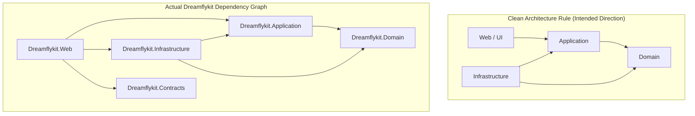

# 04. DEPENDENCY DIRECTION & REFERENCE REPORT: DREAMFLYKIT

---

## 1. Dependency Rule Verification

In Clean Architecture and Modular Monolith designs, the dependency rule states:
> *Source code dependencies must only point inward, toward higher-level policies. The Domain layer is the core. The Application layer depends only on Domain. The Infrastructure layer implements interfaces defined in Application. The Presentation (Web) layer depends on Application.*

---

## 2. Dependency Violations & Leaks

### Violation 1: Presentation Layer Directly References Infrastructure
- **Observed:** `Dreamflykit.Web.csproj` has a direct project reference to `<ProjectReference Include="..\Dreamflykit.Infrastructure\Dreamflykit.Infrastructure.csproj" />`.
- **Architectural Consequence:** Controllers have direct access to `DreamflykitDbContext`, raw entity configurations, and internal infrastructure services, bypassing the Application use-case boundary completely.
- **Industry Standard Solution:** 
  In ASP.NET Core, the Web project needs Infrastructure *only* at the composition root (`Program.cs`) for DI registration. However, by referencing Infrastructure directly, nothing prevents controllers from directly injecting `DreamflykitDbContext`. 
  To enforce strict Clean Architecture:
  1. Move `DreamflykitDbContext` usage out of all 15 controllers into Application use cases or repositories.
  2. Controllers must depend exclusively on `I<UseCase>Service` or MediatR commands/queries.

### Violation 2: The Zombie Project `Dreamflykit.Contracts`
- **Observed:** `Dreamflykit.Contracts` has 0 files, 0 classes, and 0 interfaces.
- **Observed:** `Dreamflykit.Web` and `Dreamflykit.Tests` reference `Dreamflykit.Contracts`.
- **Verdict:** Unnecessary project overhead. In a Modular Monolith with server-rendered Razor Views, a separate Contracts project is redundant unless exposing a public gRPC/OpenAPI SDK to third parties.
- **Recommendation:** Remove `Dreamflykit.Contracts` from the solution and remove references from `Web.csproj` and `Tests.csproj`.

---

## 3. Dependency Inversion Health Check

| Contract / Interface (Application) | Implementation (Infrastructure) | Dependency Inversion Status |
| :--- | :--- | :--- |
| `IProductRepository` | `ProductRepository` | **Compliant** |
| `ICategoryRepository` | `CategoryRepository` | **Compliant** |
| `ICartRepository` | `CartRepository` | **Compliant** |
| `IOrderRepository` | `OrderRepository` | **Compliant** |
| `IAddressRepository` | `AddressRepository` | **Compliant** |
| `IInventoryRepository` | `InventoryRepository` | **Compliant** |
| `IPaymentService` | `CashfreePaymentService` | **Compliant** |
| `IMediaStorageService` | `S3MediaStorageService` | **Compliant** |
| `14 I*HubService interfaces` | `14 *HubService classes` | **Architectural Leak:** Inverts dependency formally, but leaks local disk file system dependencies into application contract expectations. |
