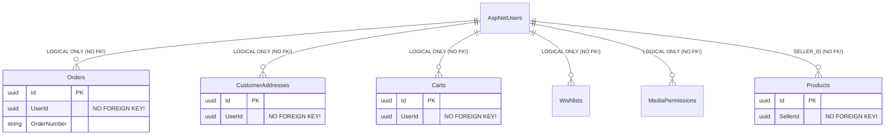

# 09. DATABASE NORMALIZATION & RELATIONSHIP INTEGRITY AUDIT: DREAMFLYKIT

**Objective:** Formal assessment against 1NF, 2NF, 3NF, BCNF, referential integrity, foreign key cascades, and denormalization.

---

## 1. Normalization Assessment (1NF, 2NF, 3NF)

| Normal Form | Compliance Status | Assessment Details |
| :--- | :--- | :--- |
| **First Normal Form (1NF)** | **Compliant** | All columns hold atomic scalar values. No repeating groups or array column hacks in core relational tables. |
| **Second Normal Form (2NF)** | **Compliant** | All non-key attributes depend on the full primary key (all surrogate UUID primary keys). |
| **Third Normal Form (3NF)** | **Partially Compliant** | Core catalogue and inventory are 3NF compliant. Denormalization exists in `Orders` (flattened shipping/billing address fields) and `CartItems` / `OrderItems` (denormalized `ProductName`, `VariantName`, `Sku`, `ImageUrl`). |
| **BCNF** | **Compliant** | Every determinant is a candidate key in normalized tables. |

---

## 2. Referential Integrity Critical Defect: Missing Foreign Keys to `AspNetUsers`

In a relational e-commerce schema, all customer-owned transactions must have referential integrity to the user identity table.

**The Finding:**
Although `AspNetUsers` exists in the database, **NONE** of the following tables define a foreign key constraint to `AspNetUsers.Id`:

### Verified Evidence from Live PostgreSQL:
Querying `information_schema.referential_constraints` for `ccu.table_name = 'AspNetUsers'`:
- `AspNetRoleClaims` -> `AspNetRoles` (FK exists)
- `AspNetUserClaims` -> `AspNetUsers` (FK exists)
- `AspNetUserLogins` -> `AspNetUsers` (FK exists)
- `AspNetUserRoles` -> `AspNetUsers` (FK exists)
- `AspNetUserTokens` -> `AspNetUsers` (FK exists)
- **`Orders` -> `AspNetUsers`: NO FOREIGN KEY!**
- **`CustomerAddresses` -> `AspNetUsers`: NO FOREIGN KEY!**
- **`Carts` -> `AspNetUsers`: NO FOREIGN KEY!**
- **`Wishlists` -> `AspNetUsers`: NO FOREIGN KEY!**
- **`Products.SellerId` -> `AspNetUsers`: NO FOREIGN KEY!**

### Business & Technical Risk:
1. **Orphaned Records:** If a user account is deleted or purged (GDPR / Right to Erasure), their orders, carts, addresses, and wishlist items remain orphaned with invalid user IDs.
2. **Ghost Sellers:** A product can be assigned to a non-existent `SellerId`, causing seller payout and catalogue queries to fail silently.
3. **Remediation:** Add explicit foreign key constraints:
   `ALTER TABLE public."Orders" ADD CONSTRAINT "FK_Orders_AspNetUsers_UserId" FOREIGN KEY ("UserId") REFERENCES public."AspNetUsers" ("Id") ON DELETE RESTRICT;`
   `ALTER TABLE public."CustomerAddresses" ADD CONSTRAINT "FK_CustomerAddresses_AspNetUsers_UserId" FOREIGN KEY ("UserId") REFERENCES public."AspNetUsers" ("Id") ON DELETE CASCADE;`
   `ALTER TABLE public."Carts" ADD CONSTRAINT "FK_Carts_AspNetUsers_UserId" FOREIGN KEY ("UserId") REFERENCES public."AspNetUsers" ("Id") ON DELETE CASCADE;`

---

## 3. Financial Denormalization Flaw in `Orders` Table

### The Finding:
The `Orders` table (30 columns) stores delivery address snapshots and timestamps, but **omits critical financial summary columns**:
- `Subtotal`: **MISSING** (computed on the fly via `Items.Sum(LineTotal)`)
- `DeliveryCharge`: **MISSING** (returns hardcoded 0 or computed value)
- `TotalDiscount`: **MISSING**
- `TaxAmount` / `GstAmount`: **MISSING**
- `GrandTotal`: **MISSING**
- `Currency`: **MISSING** (assumed INR)

### Technical Risk:
If a tax rate changes, or delivery fee logic updates, historical order totals cannot be reconstructed or audited reliably. In financial systems and GST invoicing, the order total at the time of purchase must be permanently stored in the `Orders` row.
