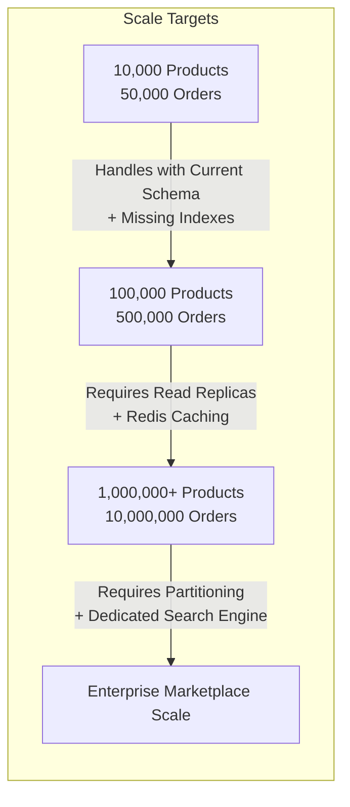

# 11. HIGH-SCALE POSTGRESQL SCALABILITY ASSESSMENT: DREAMFLYKIT

**Objective:** Architectural evaluation of database readiness for scale targets: 10k, 100k, 1M products, and millions of transactional orders.

---

## 1. Scale Target Feasibility Analysis



### Assessment by Scale Tier

| Metric | 10k Products / 50k Orders | 100k Products / 500k Orders | 1M Products / 5M Orders | 10M+ Orders |
| :--- | :--- | :--- | :--- | :--- |
| **Table Storage Size** | ~120 MB | ~1.5 GB | ~25 GB | ~250 GB+ |
| **Catalogue Query Latency** | < 10 ms | 15–40 ms | 80–250 ms (without Redis) | Requires dedicated Search |
| **Checkout Throughput** | ~50 orders/sec | ~150 orders/sec | 300+ orders/sec | Partitioned Writes |
| **Database Readiness** | **Achievable now** (once indexes added) | **Needs Redis & Connection Tuning** | **Needs Read Replicas** | **Needs Partitioning** |

---

## 2. Table Partitioning Evaluation

### Should Dreamflykit partition tables now?
**Verdict:** **NO.** Partitioning is currently premature.
- PostgreSQL tables under 50 GB perform faster with standard B-tree indexes than with partitioned tables due to partition pruning overhead and complex constraint management.

### When should partitioning be introduced?
Partitioning should be introduced when:
1. **`Orders` & `OrderItems` exceed 5 million rows (~10 GB):** Partition by `PlacedAtUtc` (Monthly range partitioning).
2. **`StockMovements` exceeds 10 million rows:** Partition by `OccurredAtUtc` (Quarterly range partitioning).
3. **`MediaAuditLogs` & `AuditLogs` exceed 20 million rows:** Partition by year for archival and cold storage pruning.

---

## 3. Database Connection Pooling & EF Core Context Lifetime

### Current Configuration in `Program.cs` & `InfrastructureServiceCollectionExtensions.cs`:
```csharp
services.AddDbContext<DreamflykitDbContext>(options => {
    options.UseNpgsql(connectionString);
});
```
- **Context Lifetime:** Scoped (Standard). Correctly disposed per HTTP request.
- **Connection Pooling:** Default Npgsql ADO.NET connection pool is enabled (Max Pool Size = 100 by default).
- **Bottleneck Risk on High Traffic (1,000+ concurrent users):**
  When multiple background tasks or heavy queries run, connection pool starvation can occur if queries block.
- **Recommendations:**
  1. Set explicit connection pool bounds in connection string:
     `Host=...;Database=...;Pooling=true;Minimum Pool Size=10;Maximum Pool Size=150;Connection Idle Lifetime=30;Timeout=15;Command Timeout=30;`
  2. Implement PgBouncer or Supabase connection pooling if deploying multiple web container instances to Hostinger VPS.
