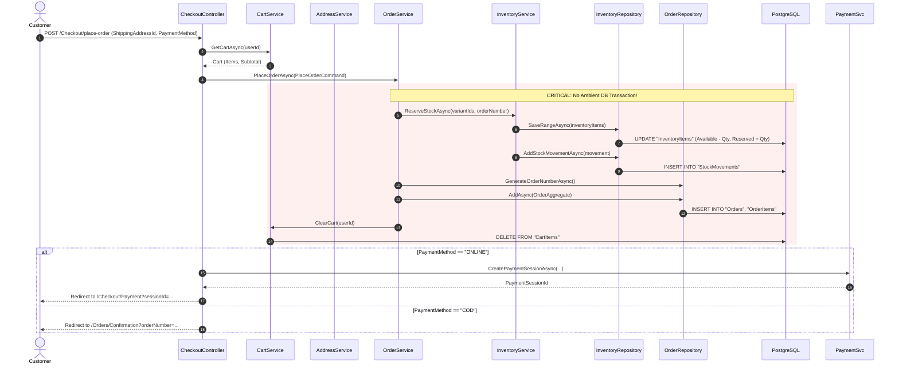
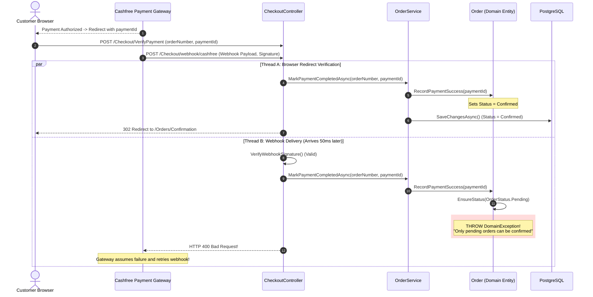
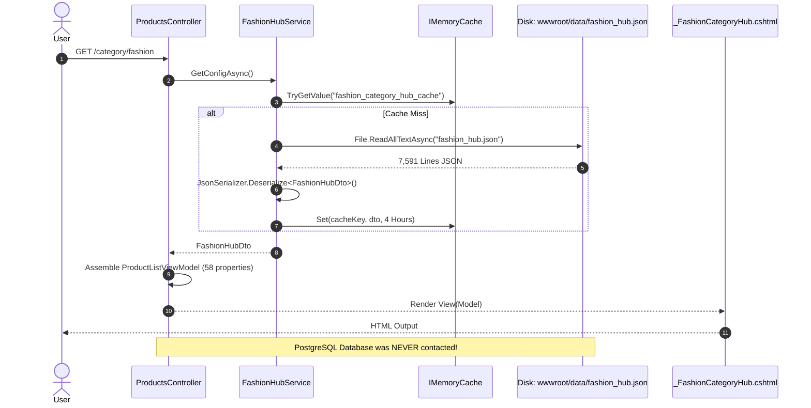

# 13. BUSINESS WORKFLOW AUDIT & SEQUENCE DIAGRAMS: DREAMFLYKIT

**Objective:** End-to-end execution path tracing, transaction boundary audit, concurrency analysis, and sequence diagram visualization of critical business workflows.

---

## 1. Sequence Diagram: Customer Checkout & Order Creation



### Risk Identified in Checkout Workflow:
If step 12 (`OrderRepo.AddAsync`) fails due to a database error, step 7 (`InventoryItems` update) has already committed! Stock is reserved permanently for an order that was never created, causing inventory leak and stock starvation.

---

## 2. Sequence Diagram: Payment Webhook vs Browser Callback Race Condition



### Root Cause:
`Order.RecordPaymentSuccess()` calls `Confirm()`, which strictly asserts `Status == OrderStatus.Pending`. In distributed payment flows, callbacks and webhooks are asynchronous and unordered.
**Remediation:** Implement idempotent state transitions:
```csharp
if (Status == OrderStatus.Confirmed) return; // Idempotent no-op
```

---

## 3. Sequence Diagram: Category Hub Request (Split-Brain Flat-File Path)


