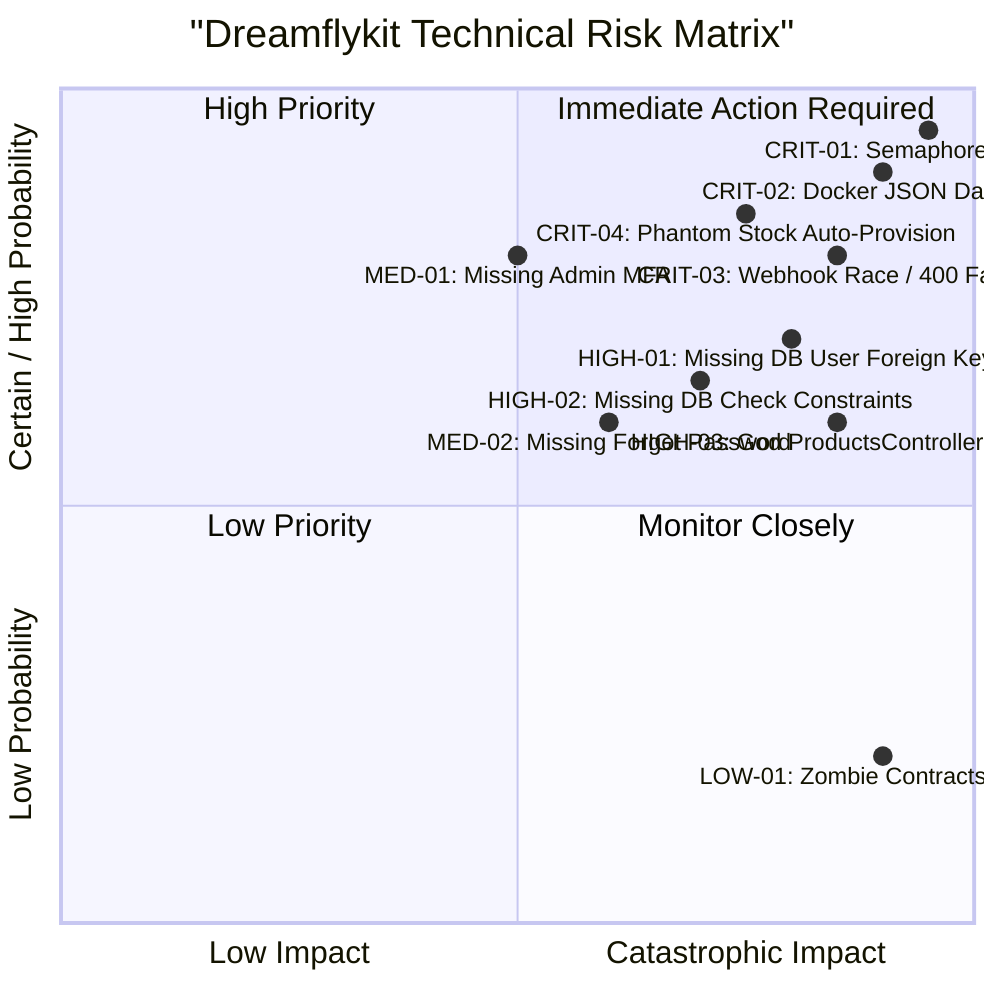

# 21. ENTERPRISE ARCHITECTURAL RISK REGISTER: DREAMFLYKIT

**Objective:** Formal enterprise risk register documenting all identified risks, likelihood, impact, severity, and mitigations.

---

## 1. Risk Heat Matrix

---

## 2. Comprehensive Risk Register

| Risk ID | Category | Description | Likelihood (1-5) | Impact (1-5) | Severity Score | Action / Mitigation Strategy |
| :--- | :--- | :--- | :--- | :--- | :--- | :--- |
| **RSK-01** | **Concurrency** | Recursive self-deadlock in `CountryKitsHubService.cs` freezes worker threads on cache miss or admin save. | 5 (Certain) | 5 (Critical) | **25 (CRITICAL)** | Remove recursive semaphore acquisition; implement non-locking internal read method. |
| **RSK-02** | **DevOps / Data** | `wwwroot/data` not mounted in Docker; container redeployment erases all admin hub configurations. | 5 (Certain) | 5 (Critical) | **25 (CRITICAL)** | Migrate Hub content to PostgreSQL database; mount persistent Docker volume as interim fix. |
| **RSK-03** | **Financial** | Cashfree payment webhook lacks idempotency; duplicate deliveries crash order status machine with HTTP 400. | 4 (High) | 5 (Critical) | **20 (CRITICAL)** | Implement `PaymentWebhookEvents` table and idempotent status transition in `Order.cs`. |
| **RSK-04** | **Inventory** | `InventoryService` creates 100 units of phantom inventory on demand, guaranteeing physical overselling. | 4 (High) | 5 (Critical) | **20 (CRITICAL)** | Throw `DomainException("Stock not available")` when inventory record does not exist in warehouse. |
| **RSK-05** | **Integrity** | `Orders`, `Addresses`, `Carts` lack foreign keys to `AspNetUsers`, causing orphaned transactional records. | 4 (High) | 4 (High) | **16 (HIGH)** | Add explicit foreign key constraints in EF Core and create database migration. |
| **RSK-06** | **Integrity** | Database check constraints configured in C# are absent in PostgreSQL schema due to migration omission. | 4 (High) | 4 (High) | **16 (HIGH)** | Create and apply EF Core migration adding `CK_ProductVariants_*` and `CK_InventoryItems_*`. |
| **RSK-07** | **Maintainability** | `ProductsController.cs` (1,873 lines) and `ProductListViewModel` (58 props) block parallel team development. | 5 (Certain) | 3 (Moderate) | **15 (HIGH)** | Decompose into separate category controllers and View Components. |
| **RSK-08** | **Security** | SuperAdmin accounts lack multi-factor authentication (MFA/2FA), exposing sensitive operations. | 3 (Moderate) | 5 (Critical) | **15 (HIGH)** | Enforce TOTP MFA for `Admin` and `SuperAdmin` roles in ASP.NET Core Identity. |
| **RSK-09** | **Customer Experience** | No Password Reset / Forgot Password functionality; locked-out users cannot recover accounts. | 4 (High) | 3 (Moderate) | **12 (MEDIUM)** | Implement tokenized Forgot Password and Reset Password actions with email delivery. |
| **RSK-10** | **Performance** | Missing index on `Orders.PaymentOrderId` forces sequential scans on every payment webhook. | 4 (High) | 3 (Moderate) | **12 (MEDIUM)** | Add partial B-tree index on `Orders.PaymentOrderId WHERE PaymentOrderId IS NOT NULL`. |
| **RSK-11** | **Operations** | Zero CI/CD workflows (`.github/workflows`); deployments rely on manual FTP/SSH file pushes. | 4 (High) | 3 (Moderate) | **12 (MEDIUM)** | Author GitHub Actions CI workflow for automated build, test, and container push. |
