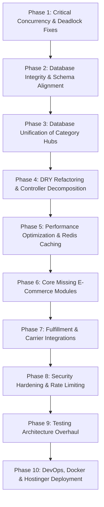

# 23. PRIORITIZED REFACTORING ROADMAP: DREAMFLYKIT

**Objective:** Sequenced, actionable 10-Phase refactoring plan. Every task includes Task ID, Description, Files Affected, Dependencies, Risk, Priority, and Acceptance Criteria.

---

## 1. Roadmap Overview

---

## 2. Phase-by-Phase Task Breakdown

### Phase 1: Critical Concurrency & Deadlock Fixes (Immediate / Week 1)
- **TASK-01: Fix Fatal SemaphoreSlim Deadlock in `CountryKitsHubService.cs`**
  - **Files:** `src/Dreamflykit.Infrastructure/CountryKits/CountryKitsHubService.cs` (lines 43, 91, 123)
  - **Risk:** High (Affects runtime stability) | **Priority:** **P0 (Immediate)**
  - **Current:** `SaveCountryProfileAsync` holds semaphore and invokes `GetAllProfilesAsync`, which re-acquires the same semaphore, hanging the thread forever.
  - **Target:** Extract `GetAllProfilesInternalAsync(ct)` that executes without acquiring the semaphore.
  - **Acceptance Criteria:** `CountryKitsHubTests.cs` passes completely without timing out.

- **TASK-02: Fix Payment Webhook Idempotency & Duplicate State Transitions**
  - **Files:** `src/Dreamflykit.Domain/Orders/Order.cs`, `src/Dreamflykit.Web/Controllers/CheckoutController.cs`
  - **Risk:** Medium | **Priority:** **P0 (Immediate)**
  - **Current:** `Order.Confirm()` throws `DomainException` if order is already confirmed.
  - **Target:** Make `RecordPaymentSuccess` idempotent (`if (Status == OrderStatus.Confirmed) return;`). Log incoming webhook events.
  - **Acceptance Criteria:** Sending identical payment webhooks returns HTTP 200 without throwing exceptions.

- **TASK-03: Enforce Ambient Database Transactions in Checkout**
  - **Files:** `src/Dreamflykit.Application/Orders/Services/OrderService.cs`
  - **Risk:** Medium | **Priority:** **P0 (Immediate)**
  - **Current:** Stock reservation, order insertion, and cart clearance execute in separate uncommitted calls.
  - **Target:** Wrap in `_dbContext.Database.BeginTransactionAsync()` with automatic rollback on error.
  - **Acceptance Criteria:** Failure to insert order rolls back stock reservation cleanly.

---

### Phase 2: Database Integrity & Schema Alignment (Week 2)
- **TASK-04: Add Missing Foreign Keys to `AspNetUsers`**
  - **Files:** `src/Dreamflykit.Infrastructure/Persistence/DreamflykitDbContext.cs`
  - **Risk:** Low | **Priority:** **P1**
  - **Target:** Add FKs: `Orders.UserId -> AspNetUsers.Id`, `CustomerAddresses.UserId -> AspNetUsers.Id`, `Carts.UserId -> AspNetUsers.Id`.
  - **Acceptance Criteria:** Foreign key constraints exist in PostgreSQL schema.

- **TASK-05: Create Migration for Missing `AuditLogs` and Check Constraints**
  - **Files:** `src/Dreamflykit.Infrastructure/Migrations/`
  - **Risk:** Low | **Priority:** **P1**
  - **Target:** Run `dotnet ef migrations add AddAuditLogsAndConstraints` and apply migration to PostgreSQL.
  - **Acceptance Criteria:** `AuditLogs` table exists in PostgreSQL; check constraints active on `ProductVariants` and `InventoryItems`.

- **TASK-06: Add Immutable Financial Summary Columns to `Orders` Table**
  - **Files:** `src/Dreamflykit.Domain/Orders/Order.cs`, `DreamflykitDbContext.cs`
  - **Risk:** Medium | **Priority:** **P1**
  - **Target:** Add columns: `Subtotal`, `DeliveryCharge`, `TotalDiscount`, `TaxAmount`, `GrandTotal`, `Currency`.

---

### Phase 3: Database Unification of Category Hubs (Weeks 3–4)
- **TASK-07: Relational Migration of Category Hub Banners & Collections**
  - **Files:** `Dreamflykit.Domain/Catalog`, `DreamflykitDbContext.cs`
  - **Risk:** High | **Priority:** **P1**
  - **Target:** Seed categories and promotional sections into PostgreSQL; deprecate 14 flat JSON files in `wwwroot/data/`.
  - **Acceptance Criteria:** Category Hub pages load data from PostgreSQL; zero reads from `wwwroot/data/*.json`.

---

### Phase 4: DRY Refactoring & Controller Decomposition (Weeks 5–6)
- **TASK-08: Decompose God `ProductsController.cs` into Contextual Controllers**
  - **Files:** `src/Dreamflykit.Web/Controllers/ProductsController.cs`
  - **Risk:** Medium | **Priority:** **P2**
  - **Target:** Split into `CatalogProductsController`, `FashionCategoryController`, `ElectronicsCategoryController`.
  - **Acceptance Criteria:** `ProductsController` reduced from 1,873 lines to < 200 lines; 15 injected services reduced to 2–3 per controller.

- **TASK-09: Convert Shared Hub Views into Reusable View Components**
  - **Files:** `Views/Shared/_*Hub.cshtml`, `ViewComponents/`
  - **Risk:** Medium | **Priority:** **P2**
  - **Target:** Implement `HeroBannerViewComponent`, `ProductCardViewComponent`, `CategoryGridViewComponent`.
  - **Acceptance Criteria:** Eliminate ~35,000 lines of duplicated Razor markup.

---

### Phase 5: Performance Optimization & Redis Caching (Week 7)
- **TASK-10: Add Missing PostgreSQL Query Indexes**
  - **Files:** PostgreSQL schema migrations
  - **Target:** Add indexes on `Orders.PaymentOrderId`, `Orders.Status`, `OrderItems.ProductVariantId`, `Products.Name (gin_trgm)`.
- **TASK-11: Integrate StackExchange.Redis Distributed Cache**
  - **Files:** `Dreamflykit.Infrastructure/DependencyInjection`
  - **Target:** Replace local `IMemoryCache` with Redis.

---

### Phase 6: Core Missing E-Commerce Modules (Weeks 8–9)
- **TASK-12: Implement Password Reset & Account Recovery**
- **TASK-13: Implement Email Notification Service (SendGrid / SMTP)**
- **TASK-14: Implement Customer Reviews & Ratings Engine in PostgreSQL**
- **TASK-15: Implement Coupon & Discount Engine**

---

### Phase 7: Fulfillment & Carrier Integrations (Week 10)
- **TASK-16: Implement Shipping Carrier Abstraction (`IShippingProvider`)**
- **TASK-17: Integrate Shiprocket / Delhivery API Adapter & Waybill Generator**

---

### Phase 8: Security Hardening & Rate Limiting (Week 11)
- **TASK-18: Enforce Admin Multi-Factor Authentication (MFA)**
- **TASK-19: Configure ASP.NET Core 8 Rate Limiter Middleware on Auth Endpoints**

---

### Phase 9: Testing Architecture Overhaul (Week 12)
- **TASK-20: Integrate Testcontainers.PostgreSql for Real Database Testing**
- **TASK-21: Author Concurrent Checkout Race Condition Tests**

---

### Phase 10: DevOps, Docker & Hostinger Deployment (Week 13)
- **TASK-22: Configure Persistent Docker Volumes & Nginx SSL Proxy**
- **TASK-23: Create GitHub Actions Automated CI/CD Workflow**
