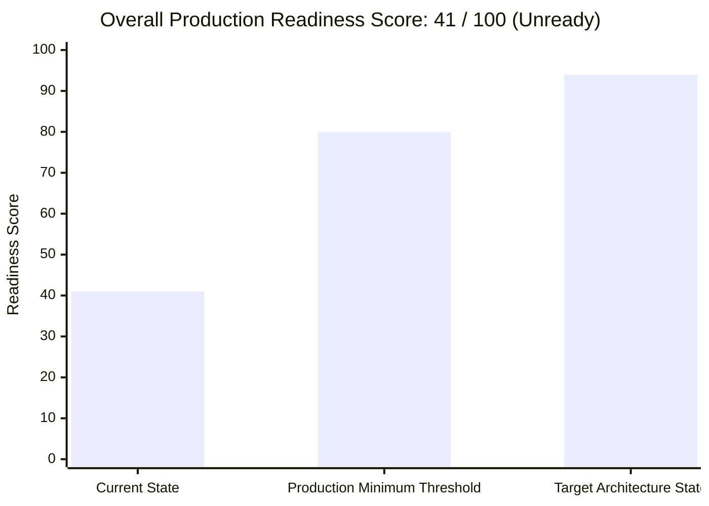

# 24. FINAL COMPLIANCE SCORECARD & ARCHITECTURAL VERDICT: DREAMFLYKIT

---

## 1. Comprehensive 16-Dimension Architectural Scorecard

| Dimension | Score (0-100) | Evaluation Criteria & Evidence | Primary Deficiencies | Path to 90+ Score |
| :--- | :--- | :--- | :--- | :--- |
| **1. Architecture Quality** | **42 / 100** | Clean Architecture intended; presentation layer tightly coupled to Infrastructure; split-brain JSON vs DB. | 15 controllers inject DbContext; 14 hubs bypass DB for JSON. | Eliminate DbContext in controllers; unify Hubs into PostgreSQL. |
| **2. Project Structure** | **58 / 100** | Solution compiles cleanly; projects logically separated into Domain, App, Infra, Web. | `Dreamflykit.Contracts` is completely empty (0 classes); bloated Hub folders in App. | Remove empty Contracts project; organize App by DDD contexts. |
| **3. Separation of Concerns** | **38 / 100** | Domain entities well-encapsulated; Web layer polluted with persistence and hub routing. | Views inject services via `@inject`; controllers construct massive view-models. | Move view queries to controllers; use View Components for layout. |
| **4. DRY / Code Duplication** | **28 / 100** | 82.5% of codebase (89k lines) is repeated across 14 hubs, DTOs, controllers, and views. | 14 identical HubServices, 14 identical Admin controllers, repeated CSS keyframes. | Centralized `CategoryHubService`, unified admin controller, View Components. |
| **5. SOLID Principles** | **35 / 100** | Interfaces defined for repositories; severe SRP violations in presentation layer. | `ProductsController` (15 services, 1,873 lines); `FashionHubDto` (5,041 lines). | Split into single-responsibility category controllers. |
| **6. Database Design** | **62 / 100** | 37 PostgreSQL tables; surrogate UUID PKs; row versioning on inventory. | Missing foreign keys to `AspNetUsers`; missing financial totals in `Orders`. | Add FK constraints to `AspNetUsers`; add order total columns. |
| **7. Database Scalability** | **45 / 100** | B-tree indexes on foreign keys; supports moderate catalog size. | Full table scans on `Orders.PaymentOrderId`; no trigram search on `Products.Name`. | Add missing partial/trigram indexes; prepare connection pooling. |
| **8. Query Performance Readiness** | **52 / 100** | EF Core queries use `AsNoTracking()` in many read paths. | Missing indexes cause sequential scans on high-traffic webhook and search paths. | Implement composite/partial B-tree and GIN trigram indexes. |
| **9. Business Logic Correctness** | **48 / 100** | Cart and Order domain entities enforce status transitions and item invariants. | Phantom stock auto-provisioning (100 units); unhandled duplicate payment webhooks. | Enforce real warehouse stock checks; idempotent webhook transitions. |
| **10. MVC Implementation** | **44 / 100** | Anti-forgery validation enabled globally; strongly-typed ViewModels used. | Extreme God Controller (`ProductsController`); 58-property `ProductListViewModel`. | Decompose into modular controllers and dedicated ViewModels. |
| **11. Application Security** | **68 / 100** | 12-char password complexity; 5-attempt account lockout; IDOR checks on UserId. | Missing Admin MFA; missing rate limiting on auth endpoints; no password reset. | Implement Admin TOTP 2FA, ASP.NET Core RateLimiter, Forgot Password. |
| **12. Reliability & Concurrency** | **36 / 100** | PostgreSQL `xmin` optimistic concurrency configured on `InventoryItem`. | **Fatal recursive deadlock in `CountryKitsHubService`**; no transactions in checkout. | Fix semaphore deadlock; wrap checkout in explicit DB transactions. |
| **13. Testing Architecture** | **40 / 100** | 115 unit tests pass in 3 seconds; Cart domain tests well-written. | 85% of tests merely assert static DTO strings; zero PostgreSQL integration tests. | Implement Testcontainers.PostgreSql integration test suite. |
| **14. Performance & Caching** | **46 / 100** | In-memory cache implemented for Hub DTOs (4-hour expiration). | No distributed Redis cache; large unbundled CSS files; file I/O latency. | Integrate Redis; bundle/minify static assets; serve media via CloudFront. |
| **15. DevOps & Deployment** | **50 / 100** | Multi-stage Docker build; non-root user execution (`UID 1654`); health checks. | `/app/wwwroot/data` not mounted in volume (data wiped on redeploy); no CI/CD. | Mount persistent volumes; add Nginx SSL proxy; create GitHub Actions. |
| **16. Overall Production Readiness**| **41 / 100** | Compiles with 0 errors; visually appealing frontend templates. | Deadlocks, container data loss, missing FKs, and split-brain architecture. | Complete Phase 1-4 remediation roadmap before public production launch. |

---

## 2. Overall Production Readiness Score: **41 / 100**

### Final Principal Architect Verdict:
**Dreamflykit is currently NOT ready for live production deployment.**
While the visual presentation and core domain concepts are promising, launching in the current state poses severe operational risks:
1. The recursive deadlock in `CountryKitsHubService.cs` will freeze server threads upon cache expiration or admin edits.
2. Deploying container updates to Hostinger VPS will wipe all administrator changes to category hubs due to unmounted Docker volumes.
3. High traffic or duplicate Cashfree webhooks will cause order failure cascades and broken customer states.

**Recommendation:**
Execute **Phase 1 (Immediate Concurrency & Deadlock Fixes)** and **Phase 2 (Database Schema & Foreign Key Corrections)** immediately prior to taking any customer orders or accepting real payments.
