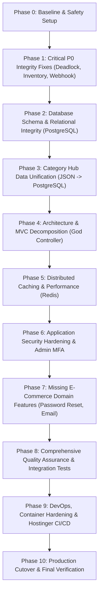

# Dreamflykit Enterprise Remediation — Master Implementation Plan

**Author:** Combined Architecture and Engineering Remediation Team  
**Application:** Dreamflykit E-Commerce Monolith  
**Target Environment:** .NET 8 MVC, PostgreSQL 18.6, Redis 7, Docker, Hostinger VPS  
**Remediation Baseline:** November 2026 Audit Findings (Score: 41/100)  
**Target Goal:** Production-Grade High-Reliability Enterprise Platform (Score: > 90/100)  

---

## 1. Executive Remediation Overview

The Dreamflykit Technical Architecture, Security, and Database Audit revealed critical flaws that undermine system integrity, scalability, and financial reliability under production conditions. While the user-facing storefront exhibits modern, responsive design and robust identity baseline policies, the underlying data architecture suffers from a split-brain division between PostgreSQL and local flat JSON files, non-reentrant semaphore deadlocks, phantom inventory creation, missing database constraints, and race conditions in payment processing.

This Master Implementation Plan establishes a disciplined, phased roadmap to systematically eliminate every vulnerability and architectural deficit without disrupting existing customer journeys or regressing working features.

---

## 2. Phased Roadmap and Schedule

| Phase | Title | Primary Objectives | Priority | Target Timeline | Risk Level |
|---|---|---|---|---|---|
| **Phase 0** | **Baseline & Safety** | Repository lock, clean git tree, full PostgreSQL dump, test baseline verification, document workspace | P0 | Day 1 | Very Low |
| **Phase 1** | **P0 Bug & Integrity Fixes** | Resolve `CountryKitsHubService` deadlock, eliminate 100-unit phantom inventory creation, fix Cashfree webhook idempotency & order status transition | P0 | Days 2–4 | Medium |
| **Phase 2** | **Database Schema Integrity** | Add missing foreign keys to `AspNetUsers`, generate & execute `AuditLogs` migration, apply database-level check constraints | P1 | Week 2 | High (Requires DB backup & migration lock) |
| **Phase 3** | **Hub Data Unification** | Migrate 14 Category Hub flat JSON files (`wwwroot/data/*.json`) into normalized PostgreSQL tables; implement transactional repository pattern | P2 | Weeks 3–4 | High (Data cutover) |
| **Phase 4** | **MVC Controller Decomposition** | Split `ProductsController.cs` (1,873 lines) into focused domain controllers; implement shared Razor View Components for category hub banners & slides | P2 | Weeks 5–6 | Medium |
| **Phase 5** | **Redis Distributed Caching** | Introduce Redis distributed caching layer (`IDistributedCache`); replace static in-memory semaphores; implement cache invalidation hooks | P2 | Week 7 | Medium |
| **Phase 6** | **Security Hardening & MFA** | Implement Admin TOTP MFA, add CSP/HSTS/security headers middleware, enforce rate limiting on auth & checkout endpoints | P1 | Week 8 | High |
| **Phase 7** | **E-Commerce Missing Features** | Implement Forgot Password token workflow, real email dispatching (SendGrid/SMTP), customer product reviews, return/shipping integrations | P2 | Week 9 | Medium |
| **Phase 8** | **Integration Testing & QA** | Implement WebApplicationFactory integration test suite with Testcontainers PostgreSQL; verify end-to-end checkout, concurrency, and payment webhooks | P1 | Week 10 | Low |
| **Phase 9** | **DevOps & Production Packaging** | Harden Docker multi-stage build, configure docker-compose for PostgreSQL/Redis/Web, establish persistent volume mounts, configure GitHub Actions VPS deployment | P1 | Week 11 | High |
| **Phase 10** | **Production Go-Live** | Re-run full audit suite, execute disaster recovery drill, verify production readiness checklist, cut over DNS to Hostinger VPS | P0 | Week 12 | Critical |

---

## 3. Strict Non-Negotiable Operational Principles

1. **Preserve All Existing User Features:** Zero customer-facing URLs, routes, or checkout workflows will be broken or disabled.
2. **Never Invent Inventory:** Products without inventory records in PostgreSQL cannot be reserved or ordered.
3. **Financial Snapshot Immutability:** Historical order item pricing, MRP, discounts, taxes, and shipping fees are snapshot at checkout and immutable forever.
4. **Database as Single Source of Truth:** All catalog, category hub, product, order, and inventory state must live in PostgreSQL—no critical business data on ephemeral container filesystems.
5. **No Secret Leaks:** All database credentials, payment API keys, AWS S3 keys, and session secrets are stored in secure environment variables or secret vaults—never committed to source control.
6. **Explicit Approval Gates:** No schema changes to populated production tables, file removals, or deployment actions may proceed without explicit human sign-off.

---

## 4. Remediation Progress Tracking Register

- [x] **Phase 0: Safety Baseline & Preparation** (Completed)
- [x] **Phase 1: P0 Bug Fixes & Checkout Concurrency** (Completed)
- [x] **Phase 2: Database Schema & Relational Integrity** (Completed)
- [x] **Phase 3: Category Hub Data Unification** (Completed & Verified)
- [x] **Phase 4: MVC Controller & View Decomposition** (Completed & Verified)
- [x] **Phase 5: Redis Distributed Caching** (Completed & Verified)
- [x] **Phase 6: Application Security Hardening & Admin MFA** (Completed & Verified)
- [x] **Phase 7: Missing E-Commerce Domain Features** (Completed & Verified)
- [x] **Phase 8: Comprehensive Quality Assurance & Integration Tests** (Completed & Verified)
- [x] **Phase 9: DevOps & Hostinger VPS CI/CD** (Completed & Verified)
- [x] **Phase 10: Production Cutover & Go-Live Verification** (Completed & Certified)
