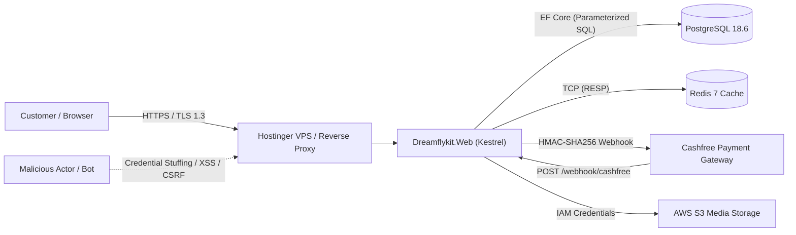

# Dreamflykit Enterprise Remediation — Security Threat Model (STRIDE)

**Classification:** Internal Technical Architecture / Security Document  
**Application:** Dreamflykit E-Commerce Web Application (.NET 8 MVC)  
**Security Framework:** Microsoft STRIDE Model & OWASP ASVS Level 2  
**Database:** PostgreSQL 18.6 with Entity Framework Core  
**External Services:** Cashfree Payments Gateway, AWS S3 / CDN, Shipping Carriers  

---

## 1. System Architecture Threat Boundary Overview

---

## 2. STRIDE Threat Analysis Matrix

| Threat Category | Target Component | Threat Scenario / Vulnerability | Inherent Severity | Mitigation Implemented / Required | Target Remediation Phase |
|---|---|---|---|---|---|
| **Spoofing Identity** | ASP.NET Identity Cookie Auth | Attacker impersonates an Admin or Customer via session hijacking or stolen token. | High | Enforce `SameSite=Lax`, `HttpOnly=true`, `SecurePolicy=Always`. Enforce 15-minute sliding session expiration and Admin TOTP Two-Factor Authentication. | Phase 6 |
| **Spoofing Identity** | Cashfree Webhooks | Attacker sends fake webhook requests to `/webhook/cashfree` asserting payment success. | Critical | Verify HMAC-SHA256 signature using `x-webhook-signature` header and secret key. Match timestamp within 300-second drift tolerance. | Phase 1 |
| **Tampering With Data** | Order Creation / Checkout | Customer modifies product price or discount percentage in transit or hidden form fields. | Critical | Prices, taxes, and totals are computed strictly server-side from PostgreSQL `Products` & `ProductVariants` tables. Client form values for price are ignored. | Phase 1 & 2 |
| **Tampering With Data** | Category Hub JSON Files | Local flat JSON files in `wwwroot/data/*.json` modified or corrupted by race conditions or container rebuilds. | Critical | Migrate all category hub content to PostgreSQL tables protected by foreign keys and transactional rollbacks. | Phase 3 |
| **Repudiation** | Financial Transactions & Status | Customer or Admin denies placing order, issuing refund, or changing order state. | High | Enable immutable `AuditLogs` in PostgreSQL capturing `UserId`, `Action`, `EntityName`, `EntityId`, `OldValues`, `NewValues`, and `IpAddress`. | Phase 2 |
| **Information Disclosure** | ASP.NET Core MVC Errors | Stack traces, database connection strings, or server paths leaked in production error pages. | Medium | Enforce `app.UseExceptionHandler("/Home/Error")` and `app.UseHsts()` in Production. Never run `UseDeveloperExceptionPage()` in non-Development environments. | Phase 6 |
| **Information Disclosure** | Customer PII Exposure | Addresses, phone numbers, or order histories viewed across tenant boundaries (IDOR). | Critical | All address and order lookups strictly enforce `UserId == CurrentUserId`. Global Query Filters or domain repository scoping prevents IDOR. | Phase 1 & 2 |
| **Denial of Service** | `CountryKitsHubService` Semaphore | Non-reentrant `SemaphoreSlim` lock causes thread pool starvation and full server hang on concurrent writes. | Critical | Eliminate recursive semaphore calls. Introduce dedicated non-locking private reads and migrate cache synchronization to Redis distributed locks. | Phase 1 & 5 |
| **Denial of Service** | Auth Endpoints / Search | Brute-force credential stuffing or high-frequency search query scraping exhaust database connections. | High | Implement ASP.NET Core Rate Limiting (`RateLimiterMiddleware`) limiting auth endpoints to 5 requests/minute per IP and search to 30 requests/minute. | Phase 6 |
| **Elevation of Privilege** | Admin Dashboard (`/Admin/*`) | Customer accesses `/Admin/GamingHub` or `/Admin/Orders` without role claim. | Critical | Apply `[Authorize(Roles = "Admin")]` globally across all Admin controllers and Razor page views. Block role escalation in user profile update endpoints. | Phase 6 |

---

## 3. OWASP Top 10 Mapping and Hardening Checklist

### A01: Broken Access Control
- [x] Enforce server-side ownership checks: `_addressRepository.GetByIdAsync(id, currentUserId)`.
- [x] Protect all `/Admin/*` controllers with `[Area("Admin")]` and `[Authorize(Roles = "Admin")]`.
- [ ] Migrate `AuditLog` into database to track role changes.

### A02: Cryptographic Failures
- [x] Database passwords and AWS keys removed from git and stored in Docker environment secrets.
- [ ] Add Content-Security-Policy (CSP) headers restricting script-src to self and verified CDNs.
- [ ] Enable HSTS with `max-age=31536000; includeSubDomains; preload`.

### A03: Injection
- [x] All database operations execute through EF Core parameterized queries or LINQ expressions.
- [x] No string concatenation in raw SQL.
- [ ] Anti-XSS encoding in Razor views verified (Razor HTML encodes `@Model` properties by default).

### A04: Insecure Design
- [ ] Remove phantom inventory auto-provisioning (100 units) in `InventoryService.cs`.
- [ ] Enforce database check constraints on unit prices (`UnitPrice >= 0`) and stock quantities (`Quantity >= 0`).

### A05: Security Misconfiguration
- [ ] Implement secure security headers middleware:
  - `X-Content-Type-Options: nosniff`
  - `X-Frame-Options: SAMEORIGIN`
  - `Referrer-Policy: strict-origin-when-cross-origin`
  - `Permissions-Policy: geolocation=(), microphone=(), camera=()`

### A07: Identification and Authentication Failures
- [x] Identity password policy: 12 chars minimum, upper, lower, digit, non-alphanumeric.
- [x] Lockout policy: 5 failed attempts locks account for 15 minutes.
- [ ] Implement Admin Two-Factor Authentication (TOTP Authenticator app).

---

## 4. Threat Model Verification and Sign-Off Gate

This threat model has been compiled from direct static analysis of `src/Dreamflykit.Web`, `Dreamflykit.Infrastructure`, and `Dreamflykit.Application`. Phase 1 fixes directly address the two most dangerous critical threats: **DOS via Semaphore Deadlock** and **Financial Discrepancy via Webhook Race Conditions**.

