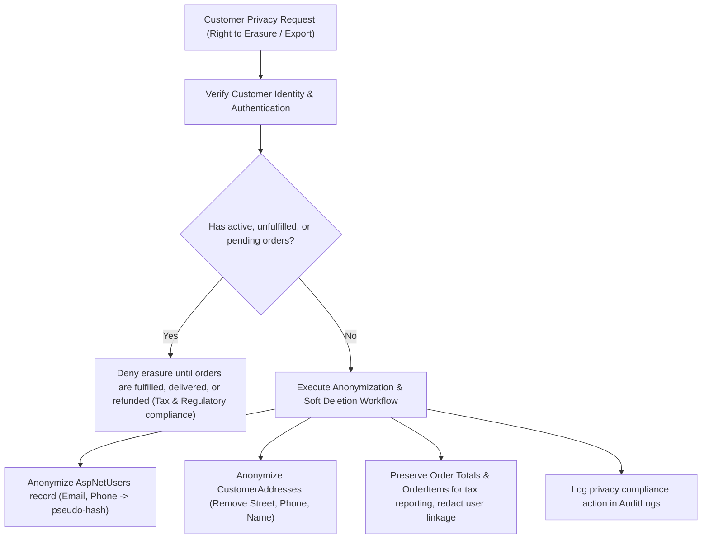

# Dreamflykit Enterprise Remediation — Data Classification and Privacy Plan

**Document:** Data Governance, Classification, and Privacy Protection Plan  
**Target Regulations:** Digital Personal Data Protection Act (DPDP), GDPR Alignment  
**Application:** Dreamflykit E-Commerce Web Application  
**Primary Database:** PostgreSQL 18.6  

---

## 1. Data Classification Tiers

| Tier | Sensitivity Level | Description | Dreamflykit Data Entities & Fields | Storage & Transmission Controls |
|---|---|---|---|---|
| **Tier 1: Restricted / PII** | Highest Sensitivity | Personally Identifiable Information that directly identifies an individual customer. | `AspNetUsers.Email`, `PhoneNumber`, `CustomerAddresses.FullName`, `AddressLine1`, `AddressLine2`, `Phone`, `PostalCode`, `OrderAddresses.*` | TLS 1.3 in transit. At-rest encryption via PostgreSQL Transparent Data Encryption or LUKS on VPS. Strict IDOR authorization checks on every fetch. |
| **Tier 2: Confidential / Financial** | High Sensitivity | Sensitive financial references, transaction tokens, and monetary records. | `Orders.TotalAmount`, `PaymentTransactionId`, `PaymentWebhookEvents.RawPayload`, `Orders.PaymentStatus` | Webhook payloads stored only for dispute resolution. Masked transaction references in customer UI. No raw credit card or bank details ever touch Dreamflykit servers (delegated to Cashfree). |
| **Tier 3: Internal / Operational** | Medium Sensitivity | Business metrics, administrative configuration, system logs, inventory levels. | `AuditLogs.*`, `InventoryItems.AvailableQuantity`, `StockMovements.*`, `AdminConfigurations`, `Categories`, `Subcategories` | Role-based access control (`Admin` role). Logs redacted for passwords, card tokens, and secret keys. Restricted to internal network or authenticated admin dashboard. |
| **Tier 4: Public** | Lowest Sensitivity | Publicly accessible catalog information. | `Products.Title`, `Description`, `Slug`, `Price`, `Mrp`, `ProductImages.Url`, `CategoryHubBanners.*` | Publicly cacheable via Redis and CDN. Open read access via public storefront controllers. |

---

## 2. Customer Privacy and Rights Handling

### 2.1 Right to Erasure (Anonymization Policy)
Under tax and commercial accounting regulations, historical financial transactions cannot be deleted. Dreamflykit satisfies the Right to Erasure through **pseudonymization and record dissociation**:
1. User profile records (`AspNetUsers`) are soft-deleted: `IsDeleted = true`, `Email = "anonymized_{Guid}@dreamflykit.invalid"`, `PhoneNumber = null`, `NormalizedEmail = null`.
2. Customer saved addresses in `CustomerAddresses` are deleted.
3. Order historical shipping records in `OrderAddresses` retain city, state, postal code, and country for financial auditing, but name and telephone numbers are scrubbed after 180 days post-delivery.

### 2.2 Right to Data Portability (Data Export)
Customers may request an export of their personal data:
- Profile details (`Email`, `PhoneNumber`, `CreatedAtUtc`).
- Saved delivery addresses.
- Order history with item summaries and payment statuses.
- Formatted as encrypted JSON archive or secure PDF.

---

## 3. PII Protection and Database Scoping

1. **Anti-IDOR Protection:** Every query for customer data in `AddressRepository`, `OrderRepository`, `CartRepository`, and `WishlistRepository` must include `WHERE "UserId" = @CurrentUserId`.
2. **Global Query Filters:** For multitenancy or soft-delete scenarios, EF Core model configuration registers `.HasQueryFilter(e => !e.IsDeleted)`.
3. **Log Sanitization:** Serilog / ILogger configurations use an AST destructuring mask to redact the following keys:
   - `Password`, `PasswordHash`, `SecurityStamp`, `x-webhook-signature`, `cf_payment_id`, `Token`, `Secret`.

