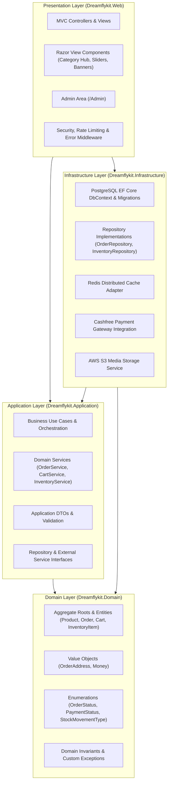

# Dreamflykit Enterprise Remediation — Architecture Target Design

**Architectural Paradigm:** Clean Architecture Modular Monolith  
**Framework:** ASP.NET Core 8 MVC  
**Runtime:** .NET 8.0 LTS (Linux x64 container)  
**Database:** PostgreSQL 18.6 with EF Core 8  
**Caching:** Redis 7 (RESP3 protocol)  

---

## 1. Modular Monolith Target Architecture Diagram

---

## 2. Layer Responsibilities & Strict Dependency Inversion

### 2.1 Dreamflykit.Domain (The Core)
- **Zero External Dependencies:** No references to EF Core, MVC, Redis, or external third-party SDKs.
- **Aggregate Roots & Entities:** `Product`, `ProductVariant`, `Order`, `OrderItem`, `Cart`, `CartItem`, `InventoryItem`, `Category`, `Subcategory`.
- **Value Objects:** `OrderAddress`, `Money`.
- **Invariants:** Domain logic and rules live inside the entities (e.g. `Order.Confirm()`, `InventoryItem.ReserveStock(quantity)`). An entity cannot enter an invalid state.
- **Domain Exceptions:** `DomainException` thrown whenever a business invariant is violated.

### 2.2 Dreamflykit.Application (Use Cases & Workflows)
- **Dependencies:** References `Dreamflykit.Domain` only.
- **Application Services:** `OrderService`, `CartService`, `InventoryService`, `ProductCatalogService`, `AddressService`.
- **Interfaces:** `IOrderRepository`, `IInventoryRepository`, `IProductRepository`, `IPaymentService`, `IShippingService`, `IEmailSender`.
- **DTOs:** Pure data transfer objects decoupling domain entities from MVC view models.
- **Transaction Boundaries:** Coordinates multi-aggregate workflows (e.g., reserving inventory during order placement).

### 2.3 Dreamflykit.Infrastructure (Persistence & External Systems)
- **Dependencies:** References `Dreamflykit.Application` and `Dreamflykit.Domain`.
- **PostgreSQL 18.6 & EF Core:** `DreamflykitDbContext`, entity configurations, migrations, connection resilience, and connection pooling.
- **Repository Implementations:** Implements repository interfaces defined in Application.
- **Redis Cache Adapter:** Implements distributed caching and cache-aside patterns.
- **Third-Party Adapters:** Cashfree payment gateway, AWS S3 file storage, SendGrid / SMTP email dispatching.

### 2.4 Dreamflykit.Web (Presentation & Hosting)
- **Dependencies:** References `Dreamflykit.Application` and `Dreamflykit.Infrastructure` (composition root only).
- **Slim MVC Controllers:** Controllers do not contain business logic, do not access `DbContext` directly, and only map requests to application services and return ViewModels.
- **Razor Views & Components:** Reusable Razor View Components (`CategoryHubBannerComponent`, `HubSliderComponent`, `CategoryGridComponent`) replace copy-pasted HTML across 14 landing hubs.
- **Security Middleware:** Enforces CSP, HSTS, Rate Limiting, Anti-CSRF, and secure session management.

---

## 3. Consolidation of Redundant Projects

### Dreamflykit.Contracts
- **Audit Finding:** The solution currently contains `Dreamflykit.Contracts.csproj` which contains 0 classes, 0 interfaces, and 0 files.
- **Architectural Decision:** In a modular monolith, DTOs and contracts belong in `Dreamflykit.Application`. Introducing a separate Contracts project creates unnecessary compilation overhead and maintenance clutter without providing benefit.
- **Action Plan:** After Phase 1 fixes and before Phase 4 MVC refactoring, safely remove `Dreamflykit.Contracts` from `Dreamflykit.slnx` after confirming zero active references.

