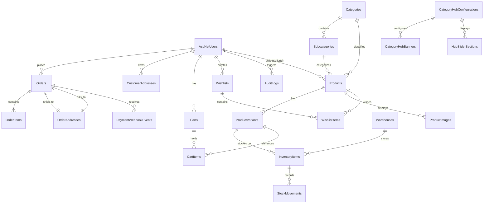
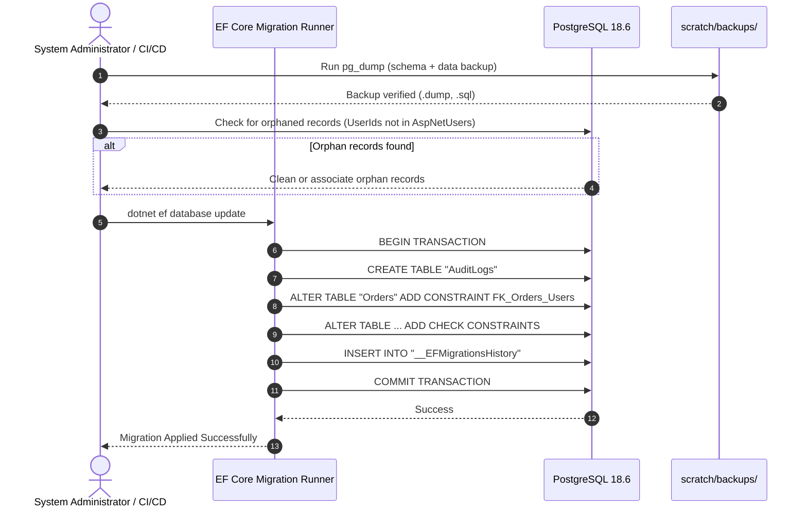

# Dreamflykit Enterprise Remediation — Database Migration Plan

**Database Engine:** PostgreSQL 18.6 x64  
**ORM:** Entity Framework Core 8.0  
**Current State:** 37 Tables, 16 Migrations Applied, Schema Drift on `AuditLog`  
**Target Goal:** 100% Relational Integrity, Foreign Keys Enforced, Custom Check Constraints, Category Hub Persistence  

---

## 1. Target Database Entity-Relationship Diagram



---

## 2. Identified Schema Deficits and Migration Sequence

### 2.1 Missing Foreign Keys to `AspNetUsers`
In the initial migrations, several tables were created with `UserId` columns without establishing formal foreign key constraints referencing `AspNetUsers(Id)` with `ON DELETE RESTRICT` or `ON DELETE CASCADE`.

| Table | Column | Target Reference | Cascade Rule | Migration Action |
|---|---|---|---|---|
| `Orders` | `UserId` | `AspNetUsers(Id)` | `ON DELETE RESTRICT` | Prevents deleting a customer account with historical financial orders. |
| `CustomerAddresses` | `UserId` | `AspNetUsers(Id)` | `ON DELETE CASCADE` | Saved addresses removed when customer account is deleted. |
| `Carts` | `UserId` | `AspNetUsers(Id)` | `ON DELETE CASCADE` | Active cart removed when customer account is deleted. |
| `Wishlists` | `UserId` | `AspNetUsers(Id)` | `ON DELETE CASCADE` | Wishlist removed when customer account is deleted. |
| `MediaPermissions` | `UserId` | `AspNetUsers(Id)` | `ON DELETE CASCADE` | Permissions revoked when user account is deleted. |
| `Products` | `SellerId` | `AspNetUsers(Id)` | `ON DELETE SET NULL` | Disconnects seller if account closed, retaining catalog item. |

### 2.2 Missing `AuditLogs` Migration
`AuditLog` is defined in `Dreamflykit.Domain.Audit` and configured in `DreamflykitDbContext.cs` line 87:
```csharp
modelBuilder.Entity<AuditLog>(b => {
    b.ToTable("AuditLogs");
    b.HasKey(x => x.Id);
    ...
});
```
However, no EF Core migration was generated, resulting in **migration drift** where the table does not exist in PostgreSQL.

**Action:** Generate migration `20261109_AddAuditLogsAndForeignKeys` to create `AuditLogs` with indexes on `UserId`, `EntityName`, and `TimestampUtc`.

### 2.3 Custom PostgreSQL Check Constraints
While EF Core ModelBuilder contains some constraints in C#, PostgreSQL `pg_constraint` currently contains 0 custom domain check constraints. We must enforce database-level invariants:
1. `CK_Products_Price_Positive`: `CHECK ("Price" >= 0)`
2. `CK_ProductVariants_Price_Positive`: `CHECK ("Price" >= 0)`
3. `CK_OrderItems_Quantity_Positive`: `CHECK ("Quantity" > 0)`
4. `CK_OrderItems_UnitPrice_Positive`: `CHECK ("UnitPrice" >= 0)`
5. `CK_InventoryItems_Quantities`: `CHECK ("AvailableQuantity" >= 0 AND "ReservedQuantity" >= 0)`
6. `CK_Discounts_Percentage`: `CHECK ("Percentage" >= 0 AND "Percentage" <= 100)`

---

## 3. Migration Rollout and Rollback Procedures



### Safety and Rollback Plan
- In the event of migration failure, EF Core rolls back the atomic transaction automatically.
- If data corruption occurs, the pre-migration baseline backup (`scratch/backups/dreamflykit_dev_baseline.dump`) can be restored in < 60 seconds via `pg_restore --clean --if-exists -d dreamflykit_dev scratch/backups/dreamflykit_dev_baseline.dump`.

