# Dreamflykit Enterprise Remediation — Category Hub & Country Kits Migration Report

**Domain Scope:** 14 Landing Hubs (Fashion, Mobiles, Electronics, Appliances, Beauty, Food, Travel, Luggage, StoryBooks, Gaming, Sports Hub, Country Kits, 3-Section Sliders)  
**Current Storage Mechanism:** Local flat JSON files in `wwwroot/data/*.json` (> 89,000 lines of JSON)  
**Target Storage Mechanism:** PostgreSQL 18.6 Relational Schema with EF Core Repository & Redis Caching  

---

## 1. Problem Definition: The Split-Brain Deficit

Currently, high-traffic customer landing pages bypass PostgreSQL entirely. When an administrator modifies hero banners, category slides, or country kit profiles via the Admin dashboard (`/Admin/GamingHub`, `/Admin/FashionHub`, etc.):
1. Data is written to `wwwroot/data/gaming_hub.json`, `wwwroot/data/country_kits_hub.json`, etc.
2. In Docker containerized deployments on Hostinger VPS, `wwwroot/data` is inside the ephemeral container filesystem.
3. Any container restart, redeploy, or blue-green cutover **permanently deletes all admin changes**.
4. Concurrency is managed via static C# `SemaphoreSlim` instances which deadlock on recursive reads (as proven in `CountryKitsHubService.cs`).

```mermaid
flowchart TD
    subgraph Current ["Current Flawed Architecture (Split-Brain)"]
        Admin1["Admin Updates Hub"] --> Controller1["HubAdminController"]
        Controller1 -->|"File.WriteAllTextAsync"| FlatJSON["wwwroot/data/*.json (Ephemeral Container File)"]
        FlatJSON -.->|"Wiped on Container Redeploy"| DataLoss["Permanent Data Loss"]
        Storefront1["Customer Requests /hub/sports"] --> Service1["HubService"]
        Service1 -->|"Static Semaphore Lock"| FlatJSON
        Service1 -.->|"Recursive Lock Acquire"| Deadlock["Deadlock / Thread Starvation"]
    end

    subgraph Target ["Target Unified Architecture (PostgreSQL + Redis)"]
        Admin2["Admin Updates Hub"] --> Controller2["CategoryHubAdminController"]
        Controller2 --> AppService["CategoryHubService"]
        AppService -->|"Atomic Transaction"| PG[("PostgreSQL 18.6 Tables")]
        AppService -->|"Evict / Set"| Redis[("Redis 7 Cache Layer")]
        Storefront2["Customer Requests /hub/sports"] --> Controller3["CategoryHubController"]
        Controller3 -->|"Cache Hit (<1ms)"| Redis
        Redis -.->|"Cache Miss Fallback"| PG
    end
```

---

## 2. PostgreSQL Target Relational Schema for Hubs

### 2.1 Table: `CategoryHubConfigurations`
- `Id` (UUID, Primary Key)
- `HubSlug` (VARCHAR(100), Unique Index - e.g., 'fashion', 'mobiles', 'sports-hub', 'electronics')
- `Title` (VARCHAR(200), Required)
- `Subtitle` (VARCHAR(500))
- `HeroBadge` (VARCHAR(100))
- `HeroBannerUrl` (VARCHAR(500))
- `HeroActionText` (VARCHAR(100))
- `HeroActionUrl` (VARCHAR(500))
- `IsActive` (BOOLEAN, Default True)
- `UpdatedAtUtc` (TIMESTAMP WITH TIME ZONE)

### 2.2 Table: `CategoryHubBanners`
- `Id` (UUID, Primary Key)
- `HubConfigurationId` (UUID, FK -> `CategoryHubConfigurations.Id` ON DELETE CASCADE)
- `Title` (VARCHAR(200))
- `Subtitle` (VARCHAR(500))
- `ImageUrl` (VARCHAR(500), Required)
- `TargetUrl` (VARCHAR(500), Required)
- `DisplayOrder` (INT, Default 0)
- `IsActive` (BOOLEAN, Default True)

### 2.3 Table: `HubSliderSections`
- `Id` (UUID, Primary Key)
- `HubConfigurationId` (UUID, FK -> `CategoryHubConfigurations.Id` ON DELETE CASCADE)
- `SectionTitle` (VARCHAR(200), Required)
- `SectionType` (VARCHAR(50) - e.g., 'ThreeColumnSlide', 'ProductCarousel', 'SubcategoryPills')
- `DisplayOrder` (INT, Default 0)
- `SectionPayloadJson` (JSONB - stores structured slide items, product variant links, discount tags)

### 2.4 Table: `CountryKitProfiles`
- `Id` (UUID, Primary Key)
- `CountrySlug` (VARCHAR(50), Unique Index - e.g., 'uk', 'usa', 'germany', 'canada')
- `CountryName` (VARCHAR(100), Required)
- `CurrencyCode` (VARCHAR(10), Required)
- `FlagEmoji` (VARCHAR(10))
- `HeroBannerUrl` (VARCHAR(500))
- `ChecklistPayloadJson` (JSONB - structured student essential checklist items)
- `IsPublished` (BOOLEAN, Default True)
- `UpdatedAtUtc` (TIMESTAMP WITH TIME ZONE)

---

## 3. Zero-Downtime Data Cutover Strategy

1. **Step 1: Automated JSON ETL Seed Script:** Execute a Python/C# database seeding migration that parses every JSON file in `wwwroot/data/`, deserializes the existing content, and writes records into PostgreSQL.
2. **Step 2: Dual-Read Fallback Service:** During cutover week, the repository checks Redis -> PostgreSQL. If a record does not exist in PostgreSQL, it falls back to the JSON file, writes to PostgreSQL, and logs a warning.
3. **Step 3: Admin Write Redirection:** All Admin controllers (`FashionHubController`, `GamingHubController`, etc.) save directly to PostgreSQL, invalidating Redis cache keys (`hub:fashion`, `hub:mobiles`).
4. **Step 4: JSON Decommission:** Once all hubs verify 100% data fidelity against PostgreSQL, the local flat JSON files are permanently archived to backup storage.

