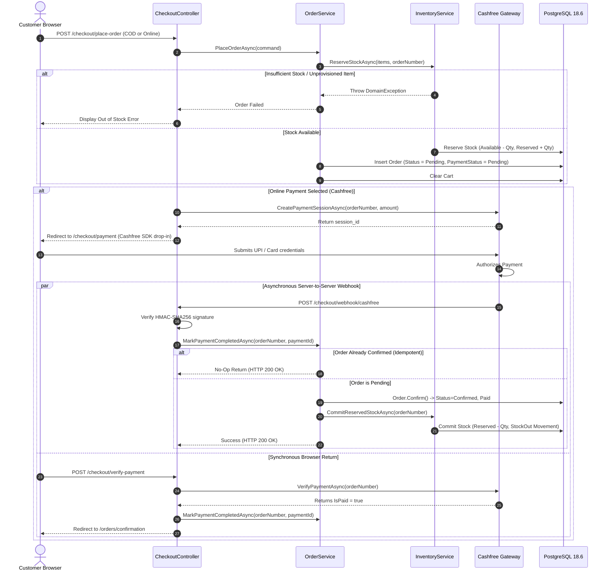

o# Dreamflykit Enterprise Remediation — Checkout & Payment Reliability

**Domain Area:** Checkout Orchestration, Cashfree Integration, Idempotency & Webhooks  
**Key Components:** `CheckoutController.cs`, `OrderService.cs`, `CashfreePaymentService.cs`, `Order.cs`  
**Target Invariant:** Zero Double-Charging, Zero Phantom Orders, Zero Duplicate Webhook Transitions  

---

## 1. End-to-End Checkout & Payment Sequence



---

## 2. Webhook Race Condition & Idempotency Resolution

### 2.1 The Race Condition
When a customer pays via Cashfree:
1. The Cashfree client SDK redirects the customer's browser to `/checkout/verify-payment`.
2. Simultaneously, Cashfree's server dispatches an asynchronous HTTP POST webhook to `/checkout/webhook/cashfree`.
3. In the previous implementation, whoever completed first transitioned `Order.Status` from `Pending` to `Confirmed`.
4. When the second caller arrived, `Order.Confirm()` threw `DomainException("Only pending orders can be confirmed.")`.
5. For the webhook, this resulted in an unhandled exception or HTTP 400 Bad Request, causing Cashfree to retry the webhook 10 times over 24 hours, cluttering logs and causing alerts.

### 2.2 The Idempotent Domain & Application Fix
In `Order.cs`:
```csharp
public void RecordPaymentSuccess(string paymentId)
{
    PaymentStatus = PaymentStatus.Paid;
    PaymentTransactionId = paymentId;
    if (Status == OrderStatus.Pending)
    {
        Confirm();
    }
}
```

In `OrderService.cs`:
```csharp
public async Task MarkPaymentCompletedAsync(
    string orderNumber,
    string paymentId,
    CancellationToken cancellationToken)
{
    var order = await _orderRepository.GetByOrderNumberAsync(orderNumber, cancellationToken);
    if (order is null) throw new DomainException($"Order {orderNumber} not found.");

    // Idempotency: If already paid and confirmed/processing, safely exit
    if (order.PaymentStatus == PaymentStatus.Paid && order.Status != OrderStatus.Pending)
    {
        return;
    }

    order.RecordPaymentSuccess(paymentId);
    await _orderRepository.UpdateAsync(order, cancellationToken);

    var itemsToCommit = order.Items.Select(i => (i.ProductVariantId, i.Quantity)).ToList();
    await _inventoryService.CommitReservedStockAsync(itemsToCommit, order.OrderNumber, cancellationToken);
}
```

---

## 3. Transaction Atomicity & Compensating Actions

To guarantee that inventory is never left permanently reserved if database persistence fails during `PlaceOrderAsync`:

```csharp
var itemsToReserve = cart.Items.Select(ci => (ci.ProductVariantId, ci.Quantity)).ToList();

try
{
    await _inventoryService.ReserveStockAsync(itemsToReserve, orderNumber, cancellationToken);
    var order = new Order(command.UserId, orderNumber, shippingSnapshot, billingSnapshot, orderItems);
    await _orderRepository.AddAsync(order, cancellationToken);
    cart.Clear();
    await _cartRepository.SaveAsync(cart, cancellationToken);
    return order.OrderNumber;
}
catch (Exception)
{
    // Compensating transaction: release reserved inventory if persistence fails
    try
    {
        await _inventoryService.ReleaseReservedStockAsync(
            itemsToReserve, orderNumber, "Order creation aborted due to persistence failure", cancellationToken);
    }
    catch (Exception exComp)
    {
        _logger.LogCritical(exComp, "Failed to release stock for aborted order {OrderNumber}", orderNumber);
    }
    throw;
}
```
