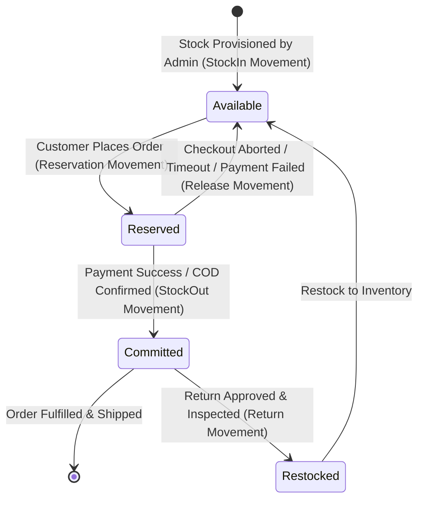

ceed# Dreamflykit Enterprise Remediation — Inventory Concurrency Design

**Domain Area:** Inventory Management, Stock Reservations & Movement Auditing  
**Key Components:** `InventoryItem.cs`, `InventoryService.cs`, `InventoryRepository.cs`, `StockMovement.cs`  
**Concurrency Pattern:** PostgreSQL Row-Level Locking (`FOR UPDATE`) & Optimistic Concurrency via `xmin`  

---

## 1. Inventory State Machine & Movement Lifecycle



---

## 2. Elimination of Phantom Inventory Creation

### 2.1 The Vulnerability
In `src/Dreamflykit.Application/Inventory/Services/InventoryService.cs` line 35:
```csharp
var invItem = inventoryItems.FirstOrDefault(i => i.ProductVariantId == variantId);
if (invItem is null)
{
    // Auto-provision initial stock for seeded catalog items (100 units)
    invItem = new InventoryItem(warehouse.Id, variantId, availableQuantity: 100, reservedQuantity: 0);
    inventoryItems.Add(invItem);
}
```
If a product variant was published in the catalog without warehouse inventory records created by admin staff, any customer checkout automatically manufactured **100 units of physical inventory in the database**, leading to unfulfillable orders and customer disputes.

### 2.2 Remediation
In `InventoryService.cs`:
```csharp
var invItem = inventoryItems.FirstOrDefault(i => i.ProductVariantId == variantId);
if (invItem is null)
{
    throw new DomainException(
        $"Inventory record not found for product variant '{variantId}'. Item is unprovisioned and cannot be ordered.");
}

if (invItem.AvailableQuantity < quantity)
{
    throw new DomainException(
        $"Insufficient stock for item. Requested: {quantity}, Available: {invItem.AvailableQuantity}.");
}
```

---

## 3. Concurrency Protection under Flash Sale Traffic

When multiple customers attempt to purchase the final unit of stock simultaneously, naive read-modify-write patterns result in race conditions and negative inventory balances.

### 3.1 PostgreSQL Row-Level Pessimistic Locking
In `InventoryRepository.cs`, the query retrieving stock for reservation must issue PostgreSQL row locks:
```sql
SELECT * FROM "InventoryItems"
WHERE "ProductVariantId" = ANY(@variantIds)
FOR UPDATE;
```
In EF Core:
```csharp
public async Task<List<InventoryItem>> GetByVariantIdsForUpdateAsync(
    IEnumerable<Guid> variantIds, 
    CancellationToken ct)
{
    var ids = variantIds.ToList();
    return await _context.InventoryItems
        .FromSqlRaw(@"SELECT * FROM ""InventoryItems"" WHERE ""ProductVariantId"" = ANY({0}) FOR UPDATE", ids)
        .ToListAsync(ct);
}
```
This forces concurrent checkout threads to queue cleanly at the database level, guaranteeing that only the customer who commits first gets the stock, while subsequent threads immediately see 0 available stock and receive an `Insufficient stock` domain error.

### 3.2 Database Check Constraints
As a secondary defense-in-depth barrier, PostgreSQL enforces:
```sql
ALTER TABLE "InventoryItems"
ADD CONSTRAINT "CK_InventoryItems_NonNegative"
CHECK ("AvailableQuantity" >= 0 AND "ReservedQuantity" >= 0);
```
Even if an application concurrency bug were introduced, PostgreSQL rejects any write that would push available or reserved quantity below zero.

