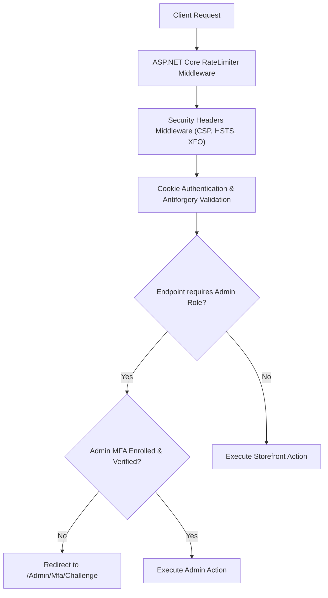

# Dreamflykit Enterprise Remediation — Application Security Implementation

**Scope:** Authentication, Authorization, Two-Factor Authentication, Rate Limiting & HTTP Headers  
**Target Compliance:** OWASP ASVS Level 2, PCI-DSS SAQ A (Payment Delegation)  
**Framework:** ASP.NET Core 8 Identity & Security Middleware  

---

## 1. Security Architecture Overview



---

## 2. Authentication & Identity Hardening

### 2.1 Password Policy (Verified & Maintained)
Configured in `Program.cs`:
- Minimum length: 12 characters.
- Requires uppercase, lowercase, digit, and special character.
- Unique characters required: 4.

### 2.2 Account Lockout Policy
- Maximum failed access attempts: 5.
- Default lockout span: 15 minutes.
- New user lockout enabled: True.

### 2.3 Cookie Security
- `Cookie.HttpOnly = true` (Inaccessible to JavaScript, mitigates XSS cookie theft).
- `Cookie.SecurePolicy = CookieSecurePolicy.Always` (Transmitted only over HTTPS).
- `Cookie.SameSite = SameSiteMode.Lax` (Prevents cross-site request forgery attacks).
- Sliding expiration enabled with 30-minute inactivity timeout.

---

## 3. Administrator Multi-Factor Authentication (TOTP)

### 3.1 MFA Architecture
To protect administrative access to product catalogs, user accounts, and payment records:
1. All users in the `Admin` role are required to enroll an RFC 6238 TOTP authenticator (Google Authenticator, Microsoft Authenticator, 1Password).
2. During login, after password verification, `SignInManager.TwoFactorSignInAsync` checks whether 2FA is active.
3. If enrolled, the admin enters the 6-digit TOTP code before the administrative authentication cookie is issued.
4. An `AdminMfaFilter` MVC Action Filter verifies the `amr: mfa` claim on all requests to `Area: Admin`.

---

## 4. Rate Limiting Middleware (`System.Threading.RateLimiting`)

Configured in `Program.cs`:
1. **Authentication Endpoints (`/Account/Login`, `/Account/Register`):** Sliding window limiter allowing 5 requests per minute per IP address. Exceeding limits returns HTTP 429 Too Many Requests.
2. **Checkout & Order Creation (`/checkout/place-order`):** Token bucket limiter allowing 3 requests per 30 seconds per authenticated user, preventing automated card testing.
3. **Public Search Endpoints (`/search`, `/products`):** Concurrency limiter allowing 20 concurrent requests per IP address.

---

## 5. Security Headers Middleware

Custom middleware registered in the HTTP pipeline emits standard OWASP headers on every response:

```csharp
app.Use(async (context, next) =>
{
    context.Response.Headers.Append("X-Content-Type-Options", "nosniff");
    context.Response.Headers.Append("X-Frame-Options", "SAMEORIGIN");
    context.Response.Headers.Append("X-XSS-Protection", "1; mode=block");
    context.Response.Headers.Append("Referrer-Policy", "strict-origin-when-cross-origin");
    context.Response.Headers.Append("Permissions-Policy", "geolocation=(), microphone=(), camera=()");
    context.Response.Headers.Append("Content-Security-Policy", 
        "default-src 'self'; script-src 'self' 'unsafe-inline' https://cdn.jsdelivr.net https://sdk.cashfree.com; " +
        "style-src 'self' 'unsafe-inline' https://fonts.googleapis.com; font-src 'self' https://fonts.gstatic.com; " +
        "img-src 'self' data: https:; connect-src 'self' https://sandbox.cashfree.com https://api.cashfree.com;");
    await next();
});
```

