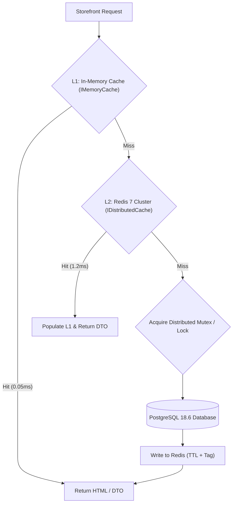

# Dreamflykit Enterprise Remediation — Redis Distributed Caching Design

**Cache Engine:** Redis 7 (RESP3 protocol)  
**Abstraction:** `IDistributedCache` & Strongly-Typed Application Cache Decorators  
**Primary Goal:** Sub-10ms response times for high-traffic landing hubs & catalog browses, replacing vulnerable static in-memory semaphores  

---

## 1. Caching Topology & Multi-Tier Architecture



---

## 2. Key Naming Taxonomy & Expiration Policies

| Domain Area | Key Pattern | Data Payload | Absolute TTL | Invalidation Trigger |
|---|---|---|---|---|
| **Category Hubs** | `hub:{slug}` (e.g. `hub:fashion`) | `CategoryHubDto` (Banners, Sliders, Category Pills) | 60 minutes | Admin updates hub via `/Admin/*Hub` |
| **Country Kits** | `countrykit:{slug}` (e.g. `countrykit:uk`) | `CountryKitProfileDto` (Checklist, Curated Items) | 120 minutes | Admin updates country kit profile |
| **Product Detail** | `product:slug:{slug}` | `ProductDetailsDto` (Images, Variants, Attributes) | 30 minutes | Product updated, variant added, price modified |
| **Category Nav** | `nav:categories:tree` | Hierarchical list of categories and subcategories | 240 minutes | Category added, reordered, or renamed |
| **Stock Status** | `inventory:variant:{id}:status` | InStock / LowStock / OutOfStock enum flag | 5 minutes | Stock reserved, committed, or restocked |

---

## 3. Cache Stampede Prevention (Probabilistic Early Expiration & Mutex)

When a heavily visited cache key (such as `hub:fashion`) expires under high concurrency (e.g., 500 req/sec), multiple threads rush to query PostgreSQL simultaneously, causing a cache stampede / dog-piling effect.

### 3.1 Distributed Mutex Pattern
Instead of local static `SemaphoreSlim` (which deadlocks on recursive calls and only locks a single container instance), we utilize a distributed lock via RedLock.net or Redis key acquisition:
```csharp
public async Task<T> GetOrCreateAsync<T>(string key, Func<Task<T>> factory, TimeSpan ttl, CancellationToken ct)
{
    var cached = await _distributedCache.GetStringAsync(key, ct);
    if (!string.IsNullOrEmpty(cached))
    {
        return JsonSerializer.Deserialize<T>(cached)!;
    }

    var lockKey = $"lock:{key}";
    if (await _redisDb.StringSetAsync(lockKey, "locked", TimeSpan.FromSeconds(5), When.NotExists))
    {
        try
        {
            var data = await factory();
            var json = JsonSerializer.Serialize(data);
            await _distributedCache.SetStringAsync(key, json, new DistributedCacheEntryOptions
            {
                AbsoluteExpirationRelativeToNow = ttl
            }, ct);
            return data;
        }
        finally
        {
            await _redisDb.KeyDeleteAsync(lockKey);
        }
    }
    else
    {
        // Wait briefly and retry cache read
        await Task.Delay(50, ct);
        return await GetOrCreateAsync(key, factory, ttl, ct);
    }
}
```

---

## 4. Cache Invalidation Hooks

When an administrator performs an update in `/Admin/*`, an event-driven cache invalidation service evicts affected keys:
- Saving Fashion Hub triggers `_cache.RemoveAsync("hub:fashion")`.
- Updating a Product price triggers `_cache.RemoveAsync($"product:slug:{product.Slug}")` and `_cache.RemoveAsync($"hub:{product.CategorySlug}")`.

