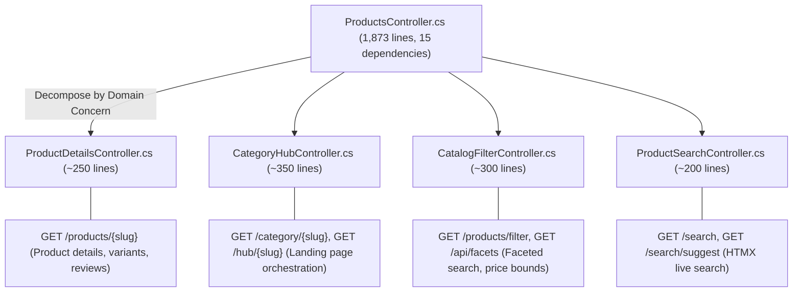

# Dreamflykit Enterprise Remediation — Refactoring & DRY Report

**Target Scope:** `ProductsController.cs` (1,873 lines), Razor View Duplication across 14 Landing Pages, Shared View Components  
**Guiding Principles:** Single Responsibility Principle (SRP), DRY, Presentation Layer Decoupling  

---

## 1. Decomposition of God Controller (`ProductsController.cs`)

### 1.1 The Problem
`src/Dreamflykit.Web/Controllers/ProductsController.cs` has swollen to **1,873 lines of code**, injecting 15 different services, handling unrelated domains:
1. Product detail pages and slug lookups.
2. Search and auto-complete suggestions.
3. Filtering and facet generation.
4. Category landing pages (Fashion, Mobiles, Food, Appliances, Electronics).
5. 3-Section mobile slider JSON parsing.
6. Admin preview toggling.

It uses a massive `ProductListViewModel.cs` containing **58 properties**, leading to fragile state and excessive memory allocations.

### 1.2 Target Controller Separation Plan

---

## 2. Shared Razor View Components (Eliminating View Duplication)

### 2.1 The Problem
Across `Views/Products/Fashion.cshtml`, `Mobiles.cshtml`, `Electronics.cshtml`, `SportsHub.cshtml`, `Food.cshtml`, etc., the identical UI patterns are duplicated:
- Full-width hero banner with subtitle, badge, and CTA button.
- "Shop by Category" circular or pill thumbnail grid.
- 3-Section product carousel / slide displays.
- Left-side facet filter sidebar with price sliders and brand checkboxes.

Whenever a styling or responsiveness fix is applied to one hub, developers must manually copy-paste the fix across 14 separate Razor view files.

### 2.2 Target View Components
We introduce standardized Razor View Components in `Dreamflykit.Web/ViewComponents/`:

1. `CategoryHeroBannerViewComponent`:
   - Renders full-width responsive hero banner with image fallback to "Uploading Soon" badge.
   - Usage: `@await Component.InvokeAsync("CategoryHeroBanner", new { hubSlug = Model.Slug })`
2. `CategoryPillGridViewComponent`:
   - Renders responsive subcategory grid with icons and links.
3. `HubThreeSectionSlideViewComponent`:
   - Renders the 3-section sliding carousel featured on Mobiles, Sports Hub, and Electronics.
4. `CatalogFilterSidebarViewComponent`:
   - Unified left-hand filter sidebar supporting HTMX dynamic updates and price filtering.

---

## 3. DTO & ViewModel Consolidation

1. Decompose `ProductListViewModel` (58 properties) into:
   - `CategoryHubViewModel`: Minimal state required for category hubs (Hero banner, subcategories, featured slides).
   - `CatalogSearchResultViewModel`: Products list, total count, active filters, pagination metadata.
2. All DTOs standardized with immutable properties (`init;` accessors) and clear XML documentation.

