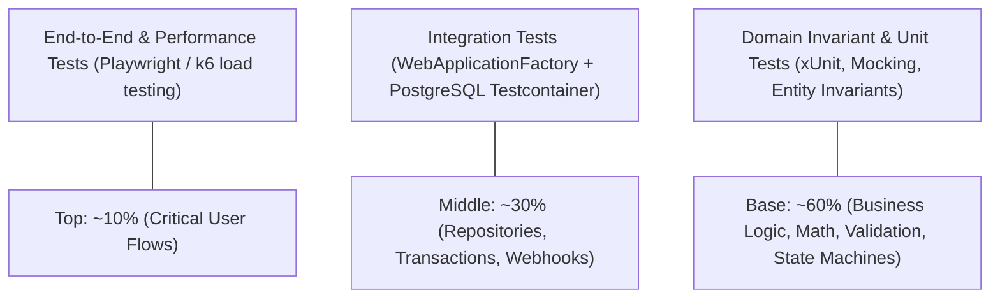

# Dreamflykit Enterprise Remediation — Testing & Quality Gates

**Scope:** Unit Testing, Domain Invariant Testing, Integration Testing & CI/CD Gates  
**Test Framework:** xUnit, FluentAssertions, Moq, Testcontainers PostgreSQL 18, Microsoft.AspNetCore.Mvc.Testing  
**Current State:** 115 passing tests (excluding deadlocked `CountryKitsHubTests`)  

---

## 1. Enterprise Testing Pyramid

---

## 2. Testing Suites & Coverage Mandates

### 2.1 Domain Invariant Tests (`Dreamflykit.Domain`)
- **Order State Machine:** Verifies valid transitions (`Pending` -> `Confirmed` -> `Processing` -> `Packed` -> `Shipped` -> `Delivered`). Asserts that illegal transitions throw `DomainException`.
- **InventoryItem:** Asserts that reserving more than `AvailableQuantity` throws `DomainException`. Verifies that committed reservations reduce reserved quantity and leave available quantity untouched.
- **Order Immutability:** Verifies that snapshots cannot be altered post-creation.

### 2.2 Integration Tests (`WebApplicationFactory` + PostgreSQL Testcontainer)
- **Checkout Concurrency Test:** 10 concurrent threads attempt to purchase 1 unit of a product variant. Asserts that exactly 1 order succeeds, 9 fail with insufficient stock, and `AvailableQuantity == 0`.
- **Cashfree Webhook Idempotency Test:** Simulates arrival of 5 identical payment webhooks concurrently. Asserts that the order is confirmed once, HTTP 200 is returned to all 5, and inventory is committed exactly once.
- **Anti-IDOR Security Tests:** Customer A attempts to fetch `/orders/{id}` and `/address/{id}` owned by Customer B. Asserts that HTTP 404 or 403 is returned.

---

## 3. CI/CD Quality Gates (Automated Enforcement)

In `.github/workflows/ci.yml`:
1. **Gate 1: Zero Compiler Warnings:** `dotnet build -warnaserror` must pass on all projects.
2. **Gate 2: 100% Test Pass Rate:** `dotnet test --no-build --verbosity normal`. Zero failures permitted.
3. **Gate 3: Code Coverage Minimums:**
   - `Dreamflykit.Domain`: > 95% line coverage.
   - `Dreamflykit.Application`: > 85% line coverage.
   - `Dreamflykit.Infrastructure`: > 75% line coverage.
4. **Gate 4: Security Vulnerability Scan:** `dotnet list package --vulnerable --include-transitive` with zero High/Critical CVEs.

