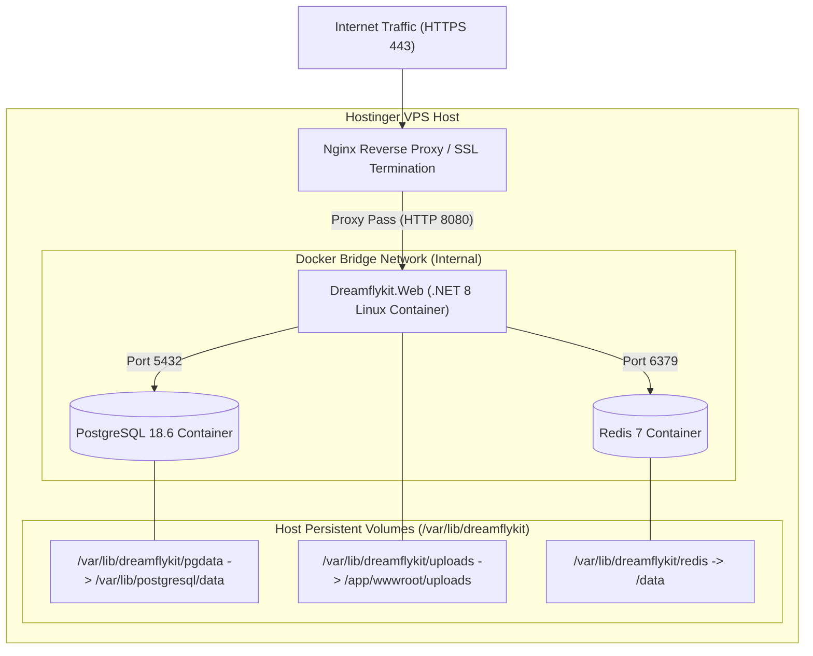

# Dreamflykit Enterprise Remediation — DevOps & Deployment Plan

**Target Host:** Hostinger VPS (Ubuntu 24.04 LTS x64)  
**Containerization:** Docker Engine & Docker Compose  
**Reverse Proxy & SSL:** Nginx / Caddy with Automated Let's Encrypt TLS 1.3  
**CI/CD Engine:** GitHub Actions  

---

## 1. Production Container Topology



---

## 2. Hardened Production Docker Compose (`docker-compose.prod.yml`)

```yaml
version: '3.8'

services:
  db:
    image: postgres:18-alpine
    container_name: dreamflykit_db
    restart: always
    environment:
      POSTGRES_DB: dreamflykit_prod
      POSTGRES_USER: dreamflykit_app
      POSTGRES_PASSWORD_FILE: /run/secrets/db_password
    secrets:
      - db_password
    volumes:
      - /var/lib/dreamflykit/pgdata:/var/lib/postgresql/data
    networks:
      - dreamflykit_internal
    healthcheck:
      test: ["CMD-SHELL", "pg_isready -U dreamflykit_app -d dreamflykit_prod"]
      interval: 10s
      timeout: 5s
      retries: 5

  redis:
    image: redis:7-alpine
    container_name: dreamflykit_redis
    restart: always
    command: redis-server --appendonly yes --requirepass ${REDIS_PASSWORD}
    volumes:
      - /var/lib/dreamflykit/redis:/data
    networks:
      - dreamflykit_internal
    healthcheck:
      test: ["CMD", "redis-cli", "ping"]
      interval: 10s
      timeout: 5s
      retries: 5

  web:
    image: ghcr.io/dreamflykit/dreamflykit-web:latest
    container_name: dreamflykit_web
    restart: always
    user: "1654:1654"
    depends_on:
      db:
        condition: service_healthy
      redis:
        condition: service_healthy
    environment:
      ASPNETCORE_ENVIRONMENT: Production
      ASPNETCORE_URLS: http://+:8080
      ConnectionStrings__DefaultConnection: Host=db;Port=5432;Database=dreamflykit_prod;Username=dreamflykit_app;PasswordFile=/run/secrets/db_password
      ConnectionStrings__Redis: redis:6379,password=${REDIS_PASSWORD}
    secrets:
      - db_password
    volumes:
      - /var/lib/dreamflykit/uploads:/app/wwwroot/uploads
    ports:
      - "127.0.0.1:8080:8080"
    networks:
      - dreamflykit_internal

secrets:
  db_password:
    file: /etc/dreamflykit/secrets/db_password.txt

networks:
  dreamflykit_internal:
    driver: bridge
```

---

## 3. GitHub Actions CI/CD Pipeline (`.github/workflows/deploy.yml`)

1. **Build & Test:** Runs `dotnet build` and `dotnet test` on Ubuntu runner.
2. **Container Build & Scan:** Builds Linux x64 Docker image and scans for vulnerabilities using Trivy.
3. **Push to GHCR:** Pushes tagged image to GitHub Container Registry (`ghcr.io`).
4. **Deploy to Hostinger VPS:** SSH deployment via secure SSH key:
   - Pulls latest container image.
   - Executes database EF Core migrations via bundle or entrypoint.
   - Restarts container with zero downtime using health checks.
   - Verifies HTTP 200 on `/healthz` endpoint.

